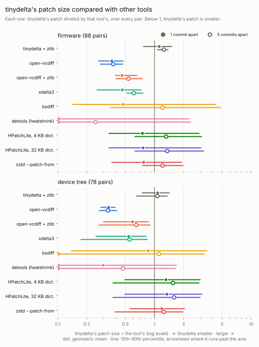
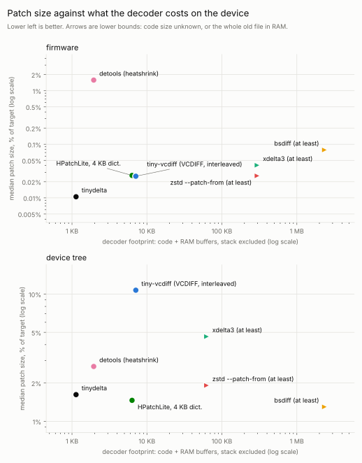
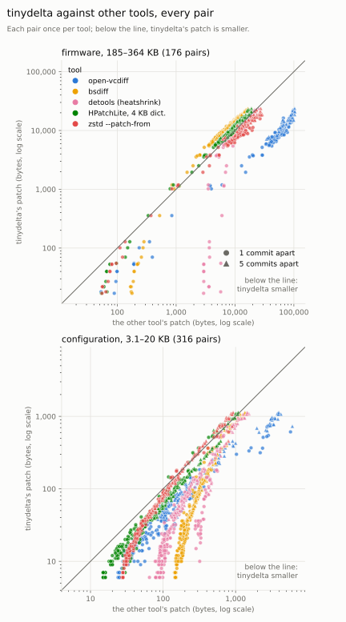

<h1 align="center">tinydelta</h1>

<p align="center">
  <b>Tiny binary patches for small devices.</b><br>
  A minimal delta format with an optimizing encoder and a C decoder that fits in under 1 KB of flash.
</p>

<p align="center">
  <a href="https://github.com/simon-b-bjerg/tinydelta/actions/workflows/ci.yml"></a>
  <a href="https://github.com/simon-b-bjerg/tinydelta/actions/workflows/ci.yml"></a>
  <a href="https://github.com/simon-b-bjerg/tinydelta/actions/workflows/ci.yml"></a>
  <a href="#conformance-vectors"></a>
  <a href="https://github.com/simon-b-bjerg/tinydelta/actions/workflows/codeql.yml"></a>
  <a href="https://github.com/simon-b-bjerg/tinydelta/releases"></a>
  <a href="https://pkg.go.dev/github.com/simon-b-bjerg/tinydelta"></a>
  <a href="LICENSE"></a>
</p>

---

tinydelta produces a patch that turns an old file (the *dictionary*) into
a new one (the *target*). It is built for updating configuration and
firmware on resource-constrained devices, where every byte sent over the
air counts and the decoder has to fit on a microcontroller.

The work is split deliberately: **the encoder does the heavy lifting** on
a server, searching hard for the smallest patch, while **the decoder
stays trivial**: four instructions, 32-bit arithmetic, no allocation and
no compression library.

## Highlights

- **Small patches.** One version byte, then a stream of short
  instructions: no framing, lengths or checksum. An unchanged region
  typically costs one or two bytes. On 166 real firmware and device-tree
  updates, smaller than open-vcdiff's in every one, typically a fifth to
  a third the size ([Benchmark](#benchmark)).
- **Optimizing encoder.** Dynamic programming over exact instruction
  costs, never worse than the built-in greedy encoder, which is
  available when speed matters more.
- **Tiny C decoder.** 472 bytes of code on Cortex-M0 when everything is
  in RAM; 852 bytes when the data lives on external flash behind your
  own read/write functions, plus an optional 300-byte page write cache.
- **No dynamic allocation, no static RAM.** The C decoders never call
  `malloc` and have no global or static variables (0 bytes of `.data`
  and `.bss`). All working state is on the stack, and the only other
  memory is buffers you pass in, so the decoders are reentrant.
- **Verified.** The C decoders are tested against the Go decoder on
  valid, truncated and corrupted patches, on x86-64, 32-bit ARM and
  16-bit MSP430 (in GNU's instruction simulator), and
  fuzzed with address and undefined-behaviour sanitizers, in CI
  ([Tests](#tests)).
- **Simple, documented format.** The full wire format fits on one page
  ([below](#wire-format)), so a decoder in another language is an
  afternoon's work, and the C decoder is easy to adapt to the I/O your
  device already has ([Your own decoder](#your-own-decoder)).

## Benchmark

166 real version pairs: builds of consecutive commits of MicroPython
firmware (two Cortex-M boards, ~300 KB) and of Linux device trees (three
boards, ~63 KB), one and five commits apart, against seven other delta
tools. Every patch was decoded again and checked against the target.
tinydelta is what an integrator ships following this README: per update,
the smaller of the plain patch and [compression mode](#compression-mode),
with a decoder that reads both.



Typical ratio of tinydelta's patch to the other tool's (geometric mean;
below 1, tinydelta's is smaller) and how often tinydelta's is smaller:

| compared with | firmware (88 pairs) | device trees (78 pairs) |
|---|---|---|
| open-vcdiff | **0.31**, smaller in 100% | **0.20**, smaller in 100% |
| xdelta3 | 0.26, smaller in 100% | 0.33, smaller in 100% |
| HPatchLite, 4 KB dictionary | 0.54, smaller in 80% | 0.86, smaller in 37% |
| bsdiff | 0.33, smaller in 62% | 0.58, smaller in 35% |
| zstd `--patch-from` | 0.49, smaller in 94% | 0.74, smaller in 78% |

tinydelta's patch is smaller than open-vcdiff's in every pair, typically
a fifth to a third of its size. Against the tools that compress their
patches it depends on the size of the change: when tinydelta's patch is
under 1 KB (85 pairs), it is the smaller one in 96% of them, typically
less than half the size of HPatchLite's; at 1 KB and above (81 pairs),
HPatchLite's is smaller in 79% of them, typically by 8%, and bsdiff's in
all of them, by about 30%.

What that compression costs on the device:



| decoder | code (Cortex-M0, `-Os`) | RAM besides stack | stack |
|---|---:|---:|---:|
| **tinydelta**, memory decoder | **472 B** | **0** | 64 B |
| **tinydelta**, callback decoder | **852 B** | **0** | ~215 B |
| HPatchLite + tinyuz | ~2.2 KB | 4–32 KB dictionary | – |
| detools + heatshrink | 1,948 B | 0 | ~1.6 KB |
| tiny-vcdiff (open-vcdiff's format) | 3,881 B | 3,221 B | ~150 B |
| bsdiff (bzip2) | – | 2.3–3.7 MB | – |

What you give up:

- **Somewhat larger patches for large changes.** Above about 1 KB of
  patch, tools that compress (HPatchLite, bsdiff, zstd) often produce
  smaller ones, for a decoder several to thousands of times larger.
- **Two passes for large changes.** A compression-mode patch is decoded
  twice, and the device stores the intermediate patch in between (see
  [below](#compression-mode)).
- **Speed was not compared.** The goal is a small decoder, not a fast one.
- **Small patch reads.** The callback decoder reads the patch a few bytes
  at a time; on slow flash, wrap `patch_read` in a small buffer.
- **No checksum, no VCDIFF compatibility.** Send a CRC or hash with the
  patch (see [On the device](#on-the-device)).
- **Your data may differ.** Two kinds of data from public projects;
  compare on your own files before choosing (`tinydelta encode -v`
  prints the patch size).

<details>
<summary>How it was measured</summary>

Pairs are builds of consecutive commits, so every one is a real change:
MicroPython's stm32 port (NUCLEO_F091RC and PYBV11) between `v1.25.0` and
`v1.26.0`, and three boards' device trees (rk3588-rock-5b, imx8mp-evk,
k3-am625-sk) between `v7.0-dts` and `v7.3-dts`. tinydelta uses the
library's default encoding, as users get it: optimal, but greedy above
roughly 100 KB, so greedy for the firmware. Each pair is encoded both
plain and in compression mode (`encode -for-compression`, then again
against an empty dictionary) and the smaller counts; both are listed on
their own in the summary, with how often each wins. The other tools run at their
smallest settings: open-vcdiff with `-target_matches`, xdelta3 `-9 -S
none`, HPatchLite `hdiffi -c-tuz-4k` (and `-32k`), detools with
heatshrink, zstd `-19 --patch-from`. Decoder code sizes are measured with
`arm-none-eabi-gcc` where the decoder builds for a microcontroller, and
otherwise taken from each tool's documentation.

The method, the scripts and how to run them are in
[`bench/README.md`](bench/README.md); the exact inputs (every commit and
SHA-256), all numbers and every graph of this run are in
[`docs/benchmark/`](docs/benchmark/), including the pair-by-pair view:



</details>


<details>
<summary>Decoder footprint notes</summary>

tinydelta's figures are from [`scripts/c-size.sh`](scripts/c-size.sh)
(`arm-none-eabi-gcc` 13.2). HPatchLite: 662 B of patch code by its own documentation plus
1,567 B for the tinyuz decompressor, measured; its dictionary is set when
the patch is created. detools and tiny-vcdiff: measured on a 230 KB
MicroPython image with each decoder linked into a small test program, with
`--gc-sections`; detools at its default heatshrink settings (larger windows
need more RAM). bsdiff: bzip2's own figures for 900 KB blocks; bspatch also
holds the old and new file in memory. Every figure and its source is in
[`bench/decoders.json`](bench/decoders.json).

</details>

## Compression mode

For updates that change a lot, `encode -for-compression`
(`EncodeOptions.ForCompression`) writes format version 2: where the new
file still lines up with the old one but a few bytes changed (moved
addresses, branch offsets), it stores the *difference* from the old
bytes, so the same shift gives the same byte everywhere. That patch is
no smaller by itself, but it compresses very well, and tinydelta can
compress it: encoded again against an empty dictionary, its repeats
become short copies.

```text
update server:  old + new ──v2──▶ inner ──v1──▶ outer     (sent)
device:         outer ──v1──▶ inner ──v2──▶ new
```

On the same 166 updates, picking the smaller of the plain and the
two-pass patch gives patches a third smaller typically, and 2.2× smaller
on large changes (patches of 1 KB and up), than plain patches alone. The
two-pass patch is the smaller in 58% of the updates; where the plain
one wins, it is by a few bytes. The [benchmark](#benchmark) counts the
smaller of the two.

Each layer starts with its version byte, and the decoders read both
versions; only the number of passes, one or two, comes from the update's metadata. The
device needs room for the inner patch between the two passes.

On the update server, make the plain patch and the two-pass one, and
send the smaller:

```sh
tinydelta encode old.bin new.bin plain.td                    # 1 pass
tinydelta encode -for-compression old.bin new.bin inner.td
tinydelta encode /dev/null inner.td twice.td                 # 2 passes
[ "$(wc -c < twice.td)" -lt "$(wc -c < plain.td)" ] && passes=2 || passes=1
```

<details>
<summary>Decoding twice on the device</summary>

Two calls of the same decoder; pass 1's result length is pass 2's patch
length:

```c
uint32_t inner_len, new_len;
tinydelta_io pass1 = {  /* outer patch, empty dictionary -> scratch area */
    .patch_read = flash_read, .patch_ctx = &patch_area, .patch_len = patch_len,
    .dict_len = 0,
    .target_read = flash_read, .target_write = flash_write,
    .target_ctx = &scratch_area, .target_cap = SCRATCH_AREA_SIZE,
};
tinydelta_result result = tinydelta_decode_io(&pass1, &inner_len);
if (result == TINYDELTA_OK) {
    tinydelta_io pass2 = {  /* inner patch, old firmware -> new firmware */
        .patch_read = flash_read, .patch_ctx = &scratch_area, .patch_len = inner_len,
        .dict_read = flash_read, .dict_ctx = &old_slot, .dict_len = old_len,
        .target_read = flash_read, .target_write = flash_write,
        .target_ctx = &new_slot, .target_cap = new_len_expected,
    };
    result = tinydelta_decode_io(&pass2, &new_len);
}
```

The final hash of the new firmware covers both passes. `-max-distance N`
(`MaxTargetDistance`) limits how far back a patch reads its own output,
for a decoder that keeps only the last N bytes.

</details>

## Why another delta format?

Established formats were not designed for a decoder that has to fit in a
few hundred bytes of flash and use no RAM:

- **VCDIFF (RFC 3284)** is a general format with windows, a 256-entry
  instruction code table, an address cache with near and same modes, and
  optional secondary compression. Its reference decoder, open-vcdiff, is
  a C++ library. A small C decoder,
  [tiny-vcdiff](https://github.com/jue89/tiny-vcdiff), only reads
  open-vcdiff's interleaved output and still needs about 4 KB of code and
  3.2 KB of static RAM.
- **bsdiff** produces a header plus three bzip2 streams. Embedded
  decoders such as [detools](https://github.com/eerimoq/detools) replace
  bzip2 with a lighter compressor (heatshrink), which brings code and
  stack back up.

tinydelta makes different trade-offs: a one-byte header, no framing or compression,
four instructions, one integer encoding and 32-bit arithmetic, with all
the effort in the encoder. The decoder is simple because the format has
almost nothing to decode.

The [benchmark](#benchmark) shows what that costs and buys.

## Contents

- [Highlights](#highlights)
- [Benchmark](#benchmark)
- [Compression mode](#compression-mode)
- [Why another delta format?](#why-another-delta-format)
- [Installation](#installation)
  - [Command-line tool](#command-line-tool)
  - [Go](#go)
  - [Python](#python)
  - [C](#c)
- [Command-line usage](#command-line-usage)
- [Go library](#go-library)
- [C library](#c-library)
  - [Code size and stack](#code-size-and-stack)
  - [Results](#results)
  - [Memory decoder](#memory-decoder)
  - [Callback decoder](#callback-decoder)
  - [Write cache](#write-cache)
  - [Your own decoder](#your-own-decoder)
  - [On the device](#on-the-device)
- [Wire format](#wire-format)
  - [Integers](#integers)
  - [Instructions](#instructions)
  - [State](#state)
  - [Rules](#rules)
  - [Example](#example)
  - [Stability](#stability)
  - [Conformance vectors](#conformance-vectors)
- [How the encoder works](#how-the-encoder-works)
- [Development](#development)
  - [Tests](#tests)
  - [Releases](#releases)
  - [Contributing](#contributing)
- [License](#license)

## Installation

### Command-line tool

Download a prebuilt static binary for Linux or Windows (amd64 or arm64)
from the [releases page](https://github.com/simon-b-bjerg/tinydelta/releases):

```sh
VERSION=v1.0.0   # pick the latest release
curl -fsSLO "https://github.com/simon-b-bjerg/tinydelta/releases/download/${VERSION}/tinydelta_${VERSION}_linux_amd64.tar.gz"
tar -xzf "tinydelta_${VERSION}_linux_amd64.tar.gz"
sudo install "tinydelta_${VERSION}_linux_amd64/tinydelta" /usr/local/bin/
```

For Windows (amd64 or arm64), download
`tinydelta_<version>_windows_amd64.zip` (or `_arm64`) from the same page, unzip it and
put `tinydelta.exe` somewhere on your `PATH`.

Each release includes `checksums.txt` with SHA-256 sums of its files.

Or build it with Go:

```sh
go install github.com/simon-b-bjerg/tinydelta/cmd/tinydelta@latest
```

### Go

```sh
go get github.com/simon-b-bjerg/tinydelta
```

### Python

```sh
pip install tinydelta
```

```python
import tinydelta

patch = tinydelta.encode(old, new)
assert tinydelta.decode(old, patch, max_size=len(new)) == new
```

The wheels (Linux and Windows, x86-64 and ARM64, Python 3.9 and later)
bundle the command-line tool, which the package runs; they also install
the `tinydelta` command. See [`python/README.md`](python/README.md).

### C

Copy the files you need from [`c/`](c/) into your project (see
[C library](#c-library)), or download `tinydelta-c_<version>.tar.gz`
from a release.

## Command-line usage

```text
tinydelta encode [-greedy] [-for-compression] [-max-len N] [-max-distance N] [-v] <dictionary> <target> [<patch>]
tinydelta decode [-max-size N] [-v] <dictionary> <patch> [<target>]
tinydelta version
```

```console
$ tinydelta encode -v old.cfg new.cfg update.td
dictionary 3566 B, target 3501 B -> patch 277 B (7.9% of target)

$ tinydelta decode old.cfg update.td restored.cfg
```

An omitted output file, or `-`, means standard output, and a patch of
`-` is read from standard input, so the commands compose with pipes.
`encode -greedy` trades a few percent of patch size for much faster
encoding. `encode -max-len N` makes sure no single instruction produces
more than N target bytes (see [below](#limiting-instruction-length)).
`encode -for-compression` and `encode -max-distance N` are for patches
that are compressed or encoded a second time (see
[Compression mode](#compression-mode)). `decode -max-size` rejects patches whose output would exceed
the given size. The exit status is 0 on success, 1 on failure and 2 on
a usage error.

## Go library

```go
import "github.com/simon-b-bjerg/tinydelta"

patch, err := tinydelta.Encode(oldFile, newFile)       // optimizing
patch, err := tinydelta.EncodeGreedy(oldFile, newFile) // fast

patch, err := tinydelta.EncodeWith(oldFile, newFile, tinydelta.EncodeOptions{
	MaxInstructionLen: 1024, // no instruction produces more than 1024 bytes
})
patch, err := tinydelta.EncodeWith(oldFile, newFile, tinydelta.EncodeOptions{
	ForCompression: true, // a patch to compress afterwards (format version 2)
})

newFile, err := tinydelta.Decode(oldFile, patch)
newFile, err := tinydelta.DecodeReaderLimit(oldFile, r, maxSize) // from an io.Reader, capped
```

| function | notes |
|---|---|
| `Encode` | Optimizing parse; roughly 100–300 ms for a few KB. Never larger than `EncodeGreedy`'s patch; falls back to greedy above roughly 100 KB to bound memory. |
| `EncodeGreedy` | One pass with one byte of lookahead; well under a millisecond for a few KB, patches typically a few percent larger. |
| `EncodeWith` | Either encoder, chosen with `EncodeOptions.Greedy`, with options such as `MaxInstructionLen`, `ForCompression` and `MaxTargetDistance` ([Compression mode](#compression-mode)). |
| `Decode`, `DecodeReader` | Apply a patch from a byte slice or an `io.Reader`. |
| `DecodeReaderLimit` | As `DecodeReader`, but fails with `ErrTooLarge` before the target would exceed a size you choose. |

Above the optimal encoder's limit, lifting it is possible but slow: on a
230 KB MicroPython image it took about 30 s on one core and gave a patch
about 2% smaller, which decodes with the same decoders.

### Limiting instruction length

`EncodeOptions.MaxInstructionLen` (CLI: `encode -max-len N`) caps how
many target bytes any one `ADD`, `SKIP`, `COPY` or `COPY_TARGET` may
produce; longer runs are split into several instructions. This helps a
decoder that handles one instruction at a time, e.g. one that needs a
bound on how long a single step takes or how much it writes. The format
and decoders are unchanged, so limited patches decode anywhere. The cost
is small: on a pair of ~3.5 KB binary device-configuration files, the
patch grows from 277 B to 281 B with a limit of 1024, and to 348 B with a
limit of 64.

Dictionary and target are limited to `MaxSize` (2³⁰ − 1 bytes); larger
inputs return `ErrTooLarge`. Malformed patches return an error, never a
panic.

## C library

Plain C99 in [`c/`](c/): 32-bit arithmetic only, no dynamic allocation,
no static RAM (0 B `.data`/`.bss`; reentrant), and no dependencies
beyond `memcpy`.

| part | files | use it when |
|---|---|---|
| **memory decoder** | `tinydelta.h`, `tinydelta_internal.h`, `tinydelta_decode.c` | dictionary, patch and output buffer are all in RAM |
| **callback decoder** | `tinydelta.h`, `tinydelta_internal.h`, `tinydelta_io.h`, `tinydelta_io.c` | the data is elsewhere, e.g. external flash, reached through your own read/write functions |
| **write cache** (optional) | `tinydelta_cache.h`, `tinydelta_cache.c` | with the callback decoder, to program flash a whole page at a time |

### Code size and stack

`arm-none-eabi-gcc` 13.2, `-Os -mthumb`, default
`TINYDELTA_SCRATCH_SIZE` (64). Code size is `.text`; `memcpy` comes from
your C library, and nothing else is pulled in (no software division
even on Cortex-M0). Reproduce with [`scripts/c-size.sh`](scripts/c-size.sh).

| part | Cortex-M0 | Cortex-M3 | Cortex-M4 | stack (Cortex-M0) |
|---|---:|---:|---:|---:|
| memory decoder | 472 B | 450 B | 452 B | 72 B |
| callback decoder | 852 B | 832 B | 834 B | ~215 B\* |
| write cache | 300 B | 288 B | 288 B | +32 B |

\* Deepest path, including the 64-byte internal buffer, excluding your
callbacks' own stack use.

On 16-bit MSP430 the code is roughly two and a half times larger, as
every 32-bit operation takes several 16-bit instructions.
`msp430-elf-gcc` 14.2, `-Os`; reproduce with
[`scripts/c-size-msp430.sh`](scripts/c-size-msp430.sh).

| part | MSP430 | MSP430X | MSP430X, `-mlarge` | stack (`-mlarge`) |
|---|---:|---:|---:|---:|
| memory decoder | 1,170 B | 1,138 B | 1,282 B | 114 B |
| callback decoder | 2,112 B | 2,054 B | 2,036 B | ~250 B\* |
| write cache | 628 B | 602 B | 678 B | +40 B |

### Results

Every decoding function returns a `tinydelta_result`:

| value | meaning |
|---|---|
| `TINYDELTA_OK` | success |
| `TINYDELTA_ERR_MALFORMED` | corrupt or truncated patch, or one that doesn't fit the dictionary |
| `TINYDELTA_ERR_TOO_LARGE` | the target would exceed its capacity, or the dictionary exceeds `TINYDELTA_MAX_SIZE` |
| `TINYDELTA_ERR_IO` | one of your callbacks failed (callback decoder only) |
| `TINYDELTA_ERR_VERSION` | the patch's version byte is neither 1 nor 2: a newer version, or not a tinydelta patch |

On any error, whatever was already written to the target is incomplete
and must not be used.

### Memory decoder

```c
tinydelta_result tinydelta_decode(const uint8_t *dict, uint32_t dict_len,
                                  const uint8_t *patch, uint32_t patch_len,
                                  uint8_t *out, uint32_t out_cap,
                                  uint32_t *out_len);
```

Writes the target into `out` and sets `*out_len`. It fails with
`TINYDELTA_ERR_TOO_LARGE` rather than write past `out_cap`.

### Callback decoder

```c
tinydelta_result tinydelta_decode_io(const tinydelta_io *io, uint32_t *target_len);
```

[`tinydelta_io`](c/tinydelta_io.h) holds your callbacks, a context
pointer for each data source, and the sizes:

| data | callbacks | access pattern |
|---|---|---|
| patch | `patch_read` | front to back, a few bytes at a time |
| dictionary | `dict_read` | random offsets |
| target | `target_write`, `target_read`, `target_flush` | writes are strictly sequential; reads are at random offsets and must return anything already written, even if still buffered; `target_flush` (optional, may be `NULL`) is called once at the end |

Offsets are relative to the start of the patch, dictionary or target. A
callback returns `TINYDELTA_CALLBACK_OK` on success; anything else stops
decoding with `TINYDELTA_ERR_IO`.

Data moves through an internal stack buffer of `TINYDELTA_SCRATCH_SIZE`
bytes (default 64; define it when compiling `tinydelta_io.c` to change
it). A larger buffer means fewer, larger callback calls. Runs of a
repeated byte, and other short repeating patterns, are expanded inside
the buffer and written in buffer-sized pieces rather than byte by byte.

### Write cache

[`tinydelta_cache`](c/tinydelta_cache.h) provides the three target
callbacks on top of your raw flash read and program functions. Writes
collect in a page buffer you provide, and flash is programmed one whole
page at a time at increasing, page-aligned offsets, plus a final partial
page. Reads come from flash for data already programmed and from the
page buffer for the rest, including reads that span both.

<details>
<summary>Example: patch, dictionary and target in three regions of one SPI flash</summary>

```c
#include "tinydelta_cache.h"

/* Your flash driver; addresses here are made up. */
extern int spi_flash_read(uint32_t addr, uint8_t *buf, uint32_t len);
extern int spi_flash_program(uint32_t addr, const uint8_t *buf, uint32_t len);
#define DICT_BASE   0x000000u   /* current config */
#define PATCH_BASE  0x010000u   /* received patch */
#define TARGET_BASE 0x020000u   /* new config, erased beforehand */

static int rd(void *base, uint32_t off, uint8_t *buf, uint32_t len) {
    return spi_flash_read((uint32_t)(uintptr_t)base + off, buf, len);
}
static int wr(void *base, uint32_t off, const uint8_t *buf, uint32_t len) {
    return spi_flash_program((uint32_t)(uintptr_t)base + off, buf, len);
}

tinydelta_result apply_patch(uint32_t dict_len, uint32_t patch_len,
                             uint32_t target_cap, uint32_t *target_len) {
    static uint8_t page[256];            /* one flash page */
    tinydelta_cache cache;
    tinydelta_io io = {
        .patch_read = rd, .patch_ctx = (void *)(uintptr_t)PATCH_BASE, .patch_len = patch_len,
        .dict_read  = rd, .dict_ctx  = (void *)(uintptr_t)DICT_BASE,  .dict_len  = dict_len,
        .target_cap = target_cap,
    };
    tinydelta_cache_init(&cache, rd, wr, (void *)(uintptr_t)TARGET_BASE, page, sizeof page);
    tinydelta_cache_attach(&cache, &io);
    return tinydelta_decode_io(&io, target_len);   /* TINYDELTA_OK on success */
}
```

</details>

### Your own decoder

The decoders here are a starting point, not the only way to use the
format. A decoder is one loop over four instructions with three
numbers of state (patch position, target position and dictionary
cursor), and [`tinydelta_decode.c`](c/tinydelta_decode.c) is 80 lines.
So rather than fitting your device around the callback interface, you
can rewrite the loop around what the device already has: a data cursor
or stream object, a flash driver with its own buffering, a file system.

A common case is external flash where small writes are expensive.
Instead of putting the write cache on top of the callback decoder,
make the decoder's scratch buffer the flash page buffer: produce target
bytes straight into it and program the page when it is full. One
buffer on the stack, no extra copy, and flash is only ever written a
page at a time.

What a custom decoder has to get right, since that's where the bugs
are:

- **`COPY_TARGET` overlap.** The source may overlap the bytes being
  written (a delta of -1 repeats the previous byte), so copy forwards,
  in pieces no longer than the distance back. With a page buffer, the
  source may also lie partly in flash and partly still in the buffer.
- **Bounds before every copy.** Check each length against the target
  capacity and against the dictionary or patch it comes from. Keep the
  arithmetic in `uint32_t` as in
  [`tinydelta_internal.h`](c/tinydelta_internal.h): a negative delta
  then wraps far above any valid position, and one unsigned check
  rejects it.
- **The version byte.** Reject any patch whose first byte isn't the
  version your decoder implements.
- **Varints.** At most 5 bytes, and the 5th may only carry 4 bits.
- **The end.** Write the last, partial page once, and only after the
  whole patch decoded successfully.

To test it, first run it against the
[conformance vectors](#conformance-vectors): each one gives a
dictionary, a patch and a capacity, and the exact result. Then add it to
the C fuzzer ([`c/fuzz/fuzz_decode.c`](c/fuzz/fuzz_decode.c)) next to
the bundled decoders. Every input there already goes through an
independent reference decoder, and yours must give the same result and
the same target bytes.

### On the device

A patch is deliberately bare: one version byte, then instructions, with
no checksum, no length and no end marker. It doesn't say which
dictionary it was made for, and a patch cut off between two
instructions still decodes, into a shorter target. Those checks belong in your update protocol, which already has
to carry the patch and usually has its own metadata.

The size of a firmware patch depends heavily on the build, not only on
the encoder. In one test, changing one string in a 230 KB MicroPython image made
the patch about 4.5 KB (2% of the image): the rebuilt image differed in several hundred
places spread across it, which looks like moved addresses and offsets,
and the data at the end was shifted by a few bytes. A reproducible build
with a stable layout should help any delta format, this one included.

#### Suggested integration

Send these alongside the patch, for example in the message or manifest
that announces the update:

| field | why |
|---|---|
| dictionary CRC or hash | applying a patch to the wrong base image decodes "successfully" into garbage |
| patch length | the decoder runs until the patch ends, so a missing tail can't be detected from the patch alone |
| target length | caps the output and detects a short result |
| target CRC or hash | the final check that the result is exactly what was encoded |

Use a CRC-32 against accidental damage, or a cryptographic hash such as
SHA-256 when the update must also be authenticated. In that case, sign
the metadata (or the target hash), not the patch: the same target can
be described by different patches.

Then, on the device:

1. **Check the dictionary** against its CRC or hash before decoding.
2. **Check the patch** has the announced length (and, if your transport
   doesn't already guarantee it, its own CRC).
3. **Decode into a separate region**, never over the dictionary:
   patching in place isn't supported. Erase it first, or erase as you
   write.
4. **Cap the output at the target length**: pass it as `out_cap` /
   `target_cap`. A short, valid patch can describe a very large target,
   and the decoders stop at the cap.
5. **Check the result**: `out_len` / `target_len` must equal the target
   length, and the target's CRC or hash must match. Only then switch
   over.

On any failure, discard the target region and keep running from the
dictionary.

## Wire format

A patch is one header byte, the **format version**, followed by a
sequence of instructions, decoded until the patch ends. There is nothing
else before, between or after them. Decoding needs the **dictionary**
(the old file) and produces the **target** (the new file).

```text
patch = version (1 byte: 0x01, or 0x02 for compression mode) + instructions
```

A decoder rejects a patch whose version byte it doesn't implement, and
a patch with no bytes at all (a header alone is valid: an empty target).
The version names the instruction set, so a future set gets a new
version, and decoders that don't know it refuse it instead of producing
a wrong target.

### Integers

Every integer is an unsigned **LEB128 varint**: 7 bits per byte, least
significant group first, high bit (`0x80`) set on every byte except the
last. A varint holds at most 32 bits: at most **5 bytes**, and the 5th
byte must be `0x00`–`0x0F`. Anything longer is invalid.

```text
300 = 0b10_0101100  ->  0xAC 0x02     (0x2C | 0x80, then 0x02)
```

Signed deltas are **zigzag**-encoded first, so small values of either
sign stay short: 0, −1, 1, −2, 2, … → 0, 1, 2, 3, 4, …
Decode with `delta = (z >> 1) ^ -(z & 1)`.

### Instructions

Each instruction starts with one varint `v`:

```text
opcode = v & 3
len    = v >> 2        // number of target bytes this instruction produces
```

| opcode | name | followed by | produces |
|---|---|---|---|
| 0 | `COPY` | zigzag `delta` | `len` bytes from `dict[cursor + delta]`, then `cursor = cursor + delta + len` |
| 1 | `ADD` | `len` literal bytes | those bytes, as-is |
| 2 | `SKIP` | — | `len` bytes from `dict[cursor]` |
| 3 | `COPY_TARGET` | zigzag `delta` | `len` bytes from the target already produced, starting at `pos + delta` (must be `< pos`), copied byte by byte |

Format version 2, made for patches that are compressed afterwards (see
[Compression mode](#compression-mode)), is identical except for opcode 3:

| opcode | name | followed by | produces |
|---|---|---|---|
| 3 | `ADD_DIFF` | `len` difference bytes | `dict[cursor + i] + byte i` (mod 256) for each of them; `[cursor, cursor + len)` must lie within the dictionary |

### State

The decoder keeps two counters, both starting at 0:

- **`pos`**: bytes of target produced so far; advances by `len` after
  every instruction.
- **`cursor`**: a read position in the dictionary; advances by `len`
  after every instruction, except that `COPY` sets it to just past the
  bytes it copied.

Without any `COPY`, `cursor` tracks `pos`, so an unchanged region of a
same-layout file is a single `SKIP`: one byte for runs of up to 31
bytes, two bytes up to 4095.

### Rules

- `COPY` with `len = 0` copies nothing but still moves `cursor`: it is
  how an encoder realigns the cursor after an insertion or deletion.
- `COPY_TARGET` copies byte by byte, so its source may overlap the bytes
  it is writing: `delta = -1` repeats the previous byte for any length.
- `COPY` and `SKIP` must stay within the dictionary; `COPY_TARGET` must
  start strictly before `pos`. Anything else is a malformed patch.
- Dictionary and target are each at most 2³⁰ − 1 bytes, which keeps
  every varint, position and delta within 32 bits.

### Example

```text
dictionary: "the quick brown fox jumps over the lazy dog"
target:     "the quick BROWN fox jumps over the lazy dog!"
patch:      01 2a 15 42 52 4f 57 4e 72 05 21       (11 bytes)

01          version 1
2a          SKIP 10        (10<<2 | 2)   "the quick "
15 ...      ADD 5          (5<<2 | 1)    "BROWN"
72          SKIP 28        (28<<2 | 2)   " fox jumps over the lazy dog"
05 21       ADD 1          (1<<2 | 1)    "!"
```

### Stability

Format versions 1 and 2 are fixed: a patch from any encoder decodes
with any decoder that implements its version, Go or C. A change to the
instruction set gets a new version byte, and decoders reject versions
they don't implement. Encoders may still produce different, usually
smaller, patches for the same input in later releases; they stay valid
patches of the same version.

Release 1.0.0 wrote patches without the version byte. Those don't
decode with later releases as they are; prepend the byte `0x01` to
convert one. The Go API
follows [semantic versioning](https://semver.org).

### Conformance vectors

[`testdata/vectors.txt`](testdata/vectors.txt) lists what a decoder
must produce for a given dictionary, patch and output capacity: the
target, or which error. It is a plain text file, one vector per line in
hex, so a decoder in any language can be checked against it; the Go
decoder and both C decoders are (`TestVectors`, `TestCVectors`).

The hand-written vectors cover each instruction and the edges of the
rules: varints of every length up to the 5-byte limit, non-minimal
varints, `COPY` with length 0, copies ending exactly at the end of the
dictionary or one byte past it, `COPY_TARGET` overlapping its own
output or pointing at or past the write position, truncated operands,
and capacities exactly reached and one byte short. A few more are real
encoder output (`gen-*`).

They also settle one thing this section leaves open: an instruction is
checked against the capacity as soon as its length is known, before its
operands are read. So an instruction that is both too large and
malformed, such as a truncated `ADD` past the capacity, is
`TOO_LARGE`.

Vectors are only ever added. If a decoder change makes an existing one
fail, the change breaks the format.

## How the encoder works

Both encoders find match candidates in the dictionary and in the target
produced so far with hash chains over 4-byte sequences, plus a direct
comparison at the cursor so that even 1–3 byte unchanged runs become a
`SKIP`.

- **Greedy** walks the target once, taking at each position the longest
  match worth more than its encoding cost, with one byte of lookahead.
- **Optimizing** (the default) runs dynamic programming over (target
  position, cursor offset), pricing every instruction at its exact
  encoded size. The cursor is what makes this worthwhile: a slightly
  shorter match that keeps the cursor aligned can save more later than
  a longer one that moves it, which is where greedy loses a few percent.

## Development

```sh
go test ./...          # Go tests, plus the C decoders if a C compiler is installed
scripts/c-check.sh     # strict C build (-Wall -Wextra -Wconversion -Wswitch-enum ... -Werror)
scripts/c-analyze.sh   # static analysis: gcc -fanalyzer, clang --analyze, clang-tidy
scripts/c-fuzz.sh 300 fuzz-corpus   # fuzz the C decoders for 5 min, keeping the corpus (needs clang with libFuzzer)
scripts/c-coverage.sh fuzz-corpus   # how much of the C library the fuzzer reaches (needs llvm-cov)
scripts/c-size.sh      # Cortex-M code size and stack (needs arm-none-eabi-gcc)
scripts/c-size-msp430.sh  # MSP430 code size and stack (needs msp430-elf-gcc)
go test -run '^$' -fuzz '^FuzzEncodeRoundTrip$' -fuzztime 5m .   # fuzz the encoders
```

### Tests

What is tested, and how:

| test | what it checks |
|---|---|
| Go unit tests (`decode_test.go`, `format_test.go`) | each instruction, varint and zigzag edge cases, the 32-bit varint limit, and that malformed patches (truncated, out of range, forward `COPY_TARGET`, huge `ADD`) fail cleanly instead of panicking |
| Round trips (`interop_test.go`, `limit_test.go`) | both encoders on fixed 3 KB fixtures and random mutations decode back exactly; `MaxInstructionLen` is respected; the optimizing encoder is never worse than greedy |
| `FuzzEncodeRoundTrip` (Go fuzzing) | derives a target from a fuzzed dictionary with a fuzzed edit script (overwrite, insert, delete, repeat, append); both encoders' patches must decode back to it, decode with an output cap of exactly the target length but fail one byte short, respect `MaxInstructionLen`, and the optimizing patch must not be larger than the greedy one |
| `TestCDecoderMatchesGo`, `TestCIODecoderMatchesGo` | both C decoders against the Go decoder on valid, truncated and corrupted patches and too-small output buffers, at several scratch-buffer and flash-page sizes; the test driver polices the callback contract (sequential whole-page programming, no reads of unwritten data) |
| `TestCIODecoderCallbackFailures` | a failing read, write or flush callback stops decoding with `TINYDELTA_ERR_IO` |
| `TestVectors`, `TestCVectors` | the Go decoder, the C memory decoder and the C callback decoder (every scratch size, with and without the page cache) against every [conformance vector](#conformance-vectors) |
| C fuzzing ([`c/fuzz/fuzz_decode.c`](c/fuzz/fuzz_decode.c)) | libFuzzer with AddressSanitizer and UndefinedBehaviorSanitizer: every input through an independent reference decoder and all C decoder configurations, which must agree exactly; any memory error, undefined behaviour or breach of the callback contract fails; injected callback failures must give `TINYDELTA_ERR_IO` |
| `scripts/c-check.sh` | the C library builds with strict warnings as errors, at scratch sizes 1, 7, 64 and 256 |
| `scripts/c-analyze.sh` | static analysis of the C library with GCC's analyzer, the Clang Static Analyzer and clang-tidy (bug-finding checks, see [`c/.clang-tidy`](c/.clang-tidy)); any finding fails |
| CodeQL | GitHub's code scanning, security and quality queries, over the Go code and the C library; results in the repository's Security tab |

Not covered: nothing runs on a real microcontroller; the Cortex-M and
MSP430 figures are measured from the compiled code, not on hardware.

<details>
<summary>How the fuzzing works</summary>

A fuzzer runs a test over and over with generated inputs. It starts
from a few seed inputs, mutates them (flips bits, inserts, deletes and
splices bytes) and watches which code each input reaches. Inputs that
reach new code are kept and mutated further, so over time it works its
way into rarely taken paths, such as a varint cut off at its 5th byte
or a copy that ends exactly at the end of the dictionary, that
hand-written tests tend to miss. Both fuzzers check properties that
must hold for every input, rather than comparing with expected output.

There are two, one for each side of the format:

- **`FuzzEncodeRoundTrip` tests the encoders** with Go's built-in
  fuzzing. Each input is a dictionary, an edit script and an
  instruction length limit. The target is built by applying the script
  to the dictionary, so dictionary and target are related as in a real
  update and the encoders produce every instruction type; two unrelated
  random files would only give one long `ADD`. Both encoders must then
  produce a patch that decodes back to the target and meets the checks
  in the table above.
- **`c/fuzz/fuzz_decode.c` tests the C decoders** with libFuzzer. Each
  input is a raw patch with a dictionary and an output capacity, so the
  fuzzer can produce anything: valid patches, truncated ones, out of
  range offsets, oversized lengths. It starts from 300 real patches
  from the Go encoders, so most inputs are nearly valid and reach deep
  into the decoders instead of being rejected at the first byte. The C
  decoders must give the same answer as a separate reference decoder,
  for valid and invalid patches alike, and must never touch memory
  outside their buffers. AddressSanitizer and
  UndefinedBehaviorSanitizer turn any out-of-bounds access, overflow
  or undefined behaviour into an immediate failure, even when the
  output happens to be correct.

</details>

<details>
<summary>What runs in CI, on every push to <code>main</code> and every pull request</summary>

| job | runs |
|---|---|
| Go tests (Go 1.21 and current) | `gofmt`, `go vet`, `go test ./...` (including the C decoder tests, built with gcc on x86-64); on current Go also 60 s of `FuzzEncodeRoundTrip` |
| C decoders fuzzed | `scripts/c-fuzz.sh 60`; crashing inputs are hex dumped in the log and uploaded as a build artifact. Then `scripts/c-coverage.sh` reports how much of the C library the corpus reaches, with the lines it never reaches, in the job summary |
| Go coverage | `go test -cover` over the library and the CLI, per function in the job summary |
| Update coverage badges | on pushes to `main` only: writes the Go and C coverage figures and the number of conformance vectors for the badges above to the `badges` branch |
| Go tests on Windows | `go test ./...` for the library and the CLI |
| Python package | on Linux and Windows, with Python 3.9 and current: the Python tests, including every conformance vector, against a fresh build of the tool; on Linux also builds the wheels, checks them with `twine` and tests the installed wheel |
| C static analysis | `scripts/c-analyze.sh` |
| CodeQL (separate workflow, also weekly) | CodeQL over the Go code and the C library |
| C library on 32-bit ARM | `scripts/c-check.sh` for x86-64 and ARM, the C decoder tests on 32-bit ARM under QEMU, and the Cortex-M code size and stack report (informational) |
| C library on MSP430 | `scripts/c-check.sh` for 16-bit MSP430 and MSP430X (small and large memory models), the C decoder tests on MSP430X under GNU's MSP430 instruction simulator, and the MSP430 code size and stack report (informational). The toolchain is built from GNU sources by [`scripts/msp430-toolchain.sh`](scripts/msp430-toolchain.sh) and cached |

</details>

<details>
<summary>Running the C tests on another architecture (ARM, MSP430)</summary>

To run the C decoder tests on another architecture, set a cross
compiler and an emulator, as CI does for 32-bit ARM:

```sh
TINYDELTA_CC="arm-linux-gnueabihf-gcc -static" TINYDELTA_C_RUNNER=qemu-arm go test -run TestC .
```

or for MSP430, as a bare-metal program in the simulator.
[`scripts/sim-run.sh`](scripts/sim-run.sh) hands the program its
arguments in a file, as bare-metal startup code passes none:

```sh
scripts/msp430-toolchain.sh && export PATH="$HOME/.cache/msp430/bin:$PATH"   # once, ~15 min
TINYDELTA_CC="msp430-elf-gcc -mcpu=msp430x -mlarge -msim" \
TINYDELTA_C_RUNNER="scripts/sim-run.sh msp430-elf-run" go test -run TestC .
```

</details>

<details>
<summary>When a fuzzer finds a failing input</summary>

A failing input from `FuzzEncodeRoundTrip` lands in `testdata/fuzz/`
and becomes a regression test once committed; hex dump it with
`TINYDELTA_FUZZ_DUMP=<file> go test -run TestDumpFuzzInput -v .`. One
from `scripts/c-fuzz.sh` lands in `fuzz-artifacts/` and is hex dumped,
split into header, dictionary and patch; replay it by passing the file
to the built `fuzz_decode` binary. In CI, both are also hex dumped in
the log and shown as an annotation on the failed job.

</details>

<details>
<summary>Optional tests with local data</summary>

Optional tests use local data when present: `TestRealConfigs`
round-trips every pair of `*.cfg` files in each subdirectory of
`testdata/private/` (git-ignored, or set `TINYDELTA_CONFIG_DIR`), and
`TestSizeVsOpenVCDiff` compares patch sizes with open-vcdiff when
`OPENVCDIFF_BIN` points at its `vcdiff` binary.

</details>

### Releases

The [release workflow](.github/workflows/release.yml) tests the tagged
code, builds static Linux and Windows binaries for amd64 and arm64 plus
a C source archive with
[`scripts/build-release.sh`](scripts/build-release.sh), and attaches
them to the GitHub release with SHA-256 checksums. It also packs the
binaries into Python wheels with
[`python/build_wheels.py`](python/build_wheels.py) and publishes them to
PyPI, through trusted publishing (no stored token). It runs when:

- a tag of the form `vX.Y.Z` is pushed (it creates the release);
- a release is published in the GitHub UI (it adds the files to it);
- you start it by hand under Actions > Release > Run workflow and give
  an existing tag.

```sh
git tag v1.0.0 && git push origin v1.0.0
```

To try the release build without publishing anything, start it by hand
and leave the tag empty: it builds the selected branch, versioned
`dev-<commit>`, and attaches the archives to the workflow run as
`release-archives` and `python-wheels`, where you can download them. A
pull request that changes the release workflow, `scripts/build-release.sh`
or the Python package does the same automatically.

Publishing to PyPI needs a one-time setup on pypi.org: add a trusted
publisher for the project `tinydelta` with this repository, the
workflow `release.yml` and the environment `pypi`. Release tags must be
`vX.Y.Z` or `vX.Y.Z-alpha.N`/`-beta.N`/`-rc.N`, which become Python
versions `X.Y.Z` and `X.Y.ZaN`/`bN`/`rcN`. A tag with a suffix is
published as a pre-release, on GitHub and on PyPI, so it never becomes
the latest release and pip only installs it when asked for.

### Contributing

Issues and pull requests are welcome. Please keep `go test ./...` and
`scripts/c-check.sh` passing and code `gofmt`-formatted. A change to the
wire format must update this README, both Go encoders, the Go decoder
and both C decoders together, with tests.

## License

[MIT](LICENSE) © 2026 Simon Bjerg
