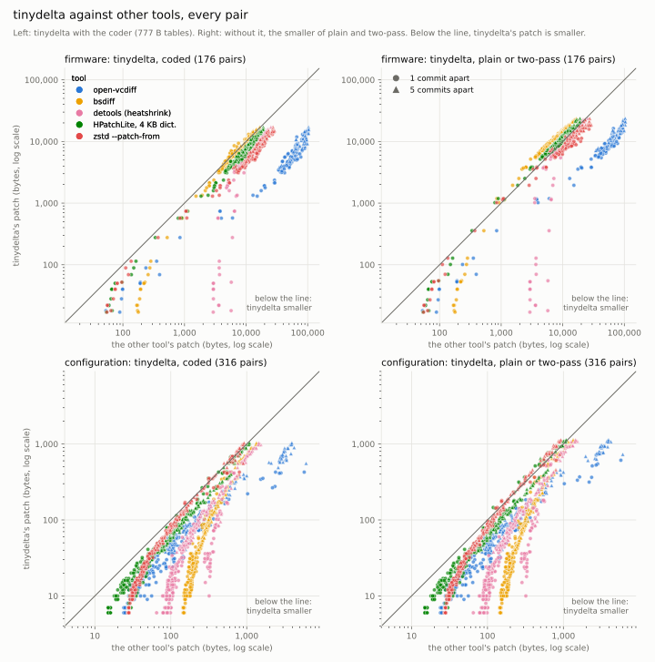
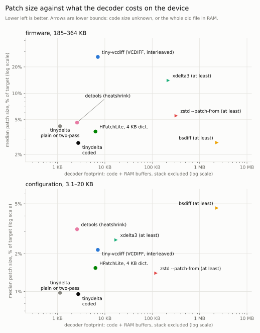
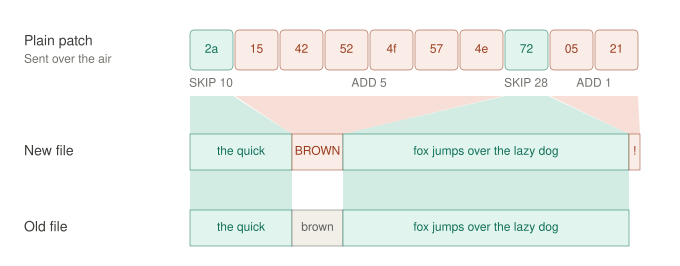
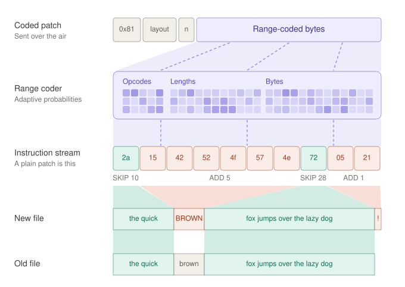
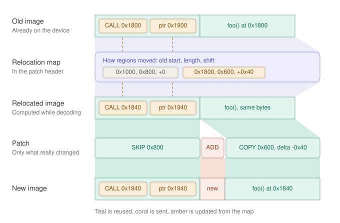
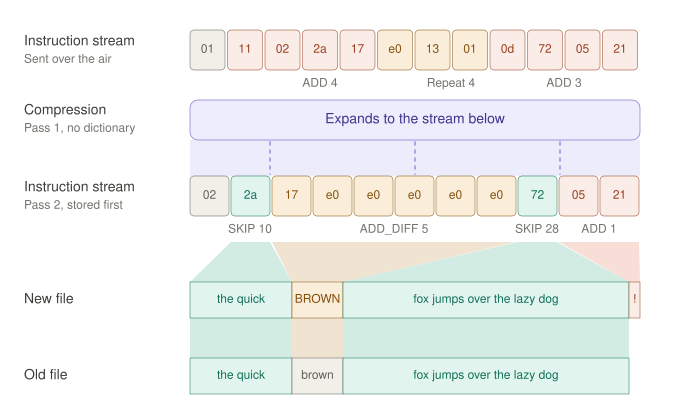

<h1 align="center">tinydelta</h1>

<p align="center">
  <b>Tiny binary patches for small devices.</b><br>
  A minimal delta format with an optimizing encoder and a C decoder that fits in under 1 KB of Cortex-M flash.
</p>

<p align="center">
  <a href="https://github.com/simon-b-bjerg/tinydelta/actions/workflows/ci.yml"></a>
  <a href="https://github.com/simon-b-bjerg/tinydelta/actions/workflows/ci.yml"></a>
  <a href="https://github.com/simon-b-bjerg/tinydelta/actions/workflows/ci.yml"></a>
  <a href="#conformance-vectors"></a>
  <a href="https://github.com/simon-b-bjerg/tinydelta/actions/workflows/codeql.yml"></a>
  <a href="https://github.com/simon-b-bjerg/tinydelta/releases"></a>
  <a href="https://pkg.go.dev/github.com/simon-b-bjerg/tinydelta"></a>
  <a href="LICENSE"></a>
</p>

---

tinydelta produces a patch that turns an old file (the *dictionary*) into
a new one (the *target*). It is built for updating configuration and
firmware on resource-constrained devices, where every byte sent over the
air counts and the decoder has to fit on a microcontroller.

The work is split deliberately: **the encoder does the heavy lifting** on
a server, searching hard for the smallest patch, while **the decoder
stays trivial**: four instructions, 32-bit arithmetic, no allocation and
no compression library.

## Highlights

- **Small patches, for configuration and firmware.** One version byte,
  then a stream of short instructions: no framing, lengths or checksum.
  An unchanged region typically costs one or two bytes, so a small change
  to a small file gives a patch of a few dozen bytes. On 316 real
  configuration updates (3–20 KB), tinydelta's patch is the smallest of
  seven tools in 89% of them, compressing tools included:
  typically 0.62× HPatchLite's and 0.20× bsdiff's. On 176 firmware
  updates, with the optional coder, it is smaller than the other
  embedded patchers' in every one (0.72× HPatchLite's, 0.41× detools')
  and typically 0.85× bsdiff's, with a decoder a fraction of their size
  ([Benchmark](#benchmark)).
- **Optimizing encoder.** Dynamic programming over exact instruction
  costs, never worse than the built-in greedy encoder, which is
  available when speed matters more.
- **Tiny C decoder.** 500 bytes of code on Cortex-M0 when everything is
  in RAM; 876 bytes when the data lives on external flash behind your
  own read/write functions, with one small buffer of yours (it can be a
  local array) as flash page cache and recent history. Optionally, it
  reads [coded patches](#coded-patches) too, about a third smaller firmware
  patches for about 0.9 KB more code on Cortex-M0 (1–1.6 KB on MSP430)
  and 0.5–1.3 KB of short-lived RAM, a trade the encoder tunes to the
  device.
- **No dynamic allocation, no static RAM.** The C decoders never call
  `malloc` and have no global or static variables (0 bytes of `.data`
  and `.bss`). All working state is on the stack, and the only other
  memory is buffers you pass in, so the decoders are reentrant.
- **Verified.** The C decoders are tested against the Go decoder on
  valid, truncated and corrupted patches, on x86-64, 32-bit ARM and
  16-bit MSP430 (in GNU's instruction simulator), fuzzed with address
  and undefined-behaviour sanitizers, and model-checked with CBMC for
  every input up to small bounds, in CI ([Tests](#tests)).
- **Simple, documented format.** The wire format fits on one page, the
  optional coder on another ([below](#wire-format)), so a decoder in another language is an
  afternoon's work, and the C decoder is easy to adapt to the I/O your
  device already has ([Your own decoder](#your-own-decoder)).

## Quick start

```sh
pip install tinydelta                            # or a prebuilt binary, see Installation
tinydelta encode -v old.bin new.bin update.td
tinydelta decode old.bin update.td restored.bin
```

On the device, with everything in RAM (`tinydelta.h`, `tinydelta_internal.h`
and `tinydelta_decode.c` from [`c/`](c/)):

```c
uint32_t new_len;
tinydelta_result_t result = tinydelta_decode(old_image, old_len, patch, patch_len, new_image, new_capacity, &new_len);
```

For data on external flash, use the [callback decoder](#callback-decoder).
A patch carries no checksum, so before shipping, read
[On the device](#on-the-device).

## Contents

- [Benchmark](#benchmark)
- [Plain patches](#plain-patches)
- [Coded patches](#coded-patches)
- [Relocation](#relocation)
- [Two-pass patches](#two-pass-patches)
- [Why another delta format?](#why-another-delta-format)
- [Installation](#installation)
  - [Command-line tool](#command-line-tool)
  - [Go](#go)
  - [Python](#python)
  - [C](#c)
- [Command-line usage](#command-line-usage)
- [Go library](#go-library)
- [C library](#c-library)
  - [Code size and stack](#code-size-and-stack)
  - [Results](#results)
  - [Memory decoder](#memory-decoder)
  - [Callback decoder](#callback-decoder)
  - [Your own decoder](#your-own-decoder)
  - [On the device](#on-the-device)
  - [C coding rules](#c-coding-rules)
- [Wire format](#wire-format)
  - [Integers](#integers)
  - [Instructions](#instructions)
  - [State](#state)
  - [Rules](#rules)
  - [Example](#example)
  - [Coded form](#coded-form)
  - [Relocation map](#relocation-map)
  - [Stability](#stability)
  - [Conformance vectors](#conformance-vectors)
- [How the encoder works](#how-the-encoder-works)
- [Development](#development)
  - [Tests](#tests)
  - [Contributing](#contributing)
- [License](#license)

## Benchmark

492 real version pairs, one and five commits apart, against six other
delta tools: firmware (MicroPython builds for four Cortex-M boards,
185–364 KB) and configuration (Linux kernel configuration files and
microcontroller device trees, 3–20 KB). Every patch was decoded again
and checked against the target.
For each update, tinydelta's figure is its [coded patch](#coded-patches)
for a decoder with 777 B of coder tables (or the plain patch, when that
is smaller), the one an update server would send. The trade-off graph
also shows tinydelta without the coder: the smaller of its plain and
[two-pass](#two-pass-patches) patch.



Typical ratio of tinydelta's patch to the other tool's (geometric mean;
below 1, tinydelta's is smaller) and how often tinydelta's is smaller:

| compared with | configuration, 3–20 KB (316 pairs) | firmware, 185–364 KB (176 pairs) |
|---|---|---|
| open-vcdiff | **0.36**, smaller in 100% | **0.12**, smaller in 100% |
| xdelta3 | 0.33, smaller in 100% | 0.21, smaller in 100% |
| HPatchLite, 4 KB dictionary | **0.62**, smaller in 97% | **0.72**, smaller in 100% |
| detools (heatshrink) | 0.25, smaller in 100% | 0.41, smaller in 100% |
| bsdiff | **0.20**, smaller in 100% | 0.85, smaller in 67% |
| zstd `--patch-from` | 0.63, smaller in 90% | 0.51, smaller in 100% |

tinydelta's patch is smaller than the VCDIFF tools', detools' and
zstd's in every firmware pair, and than HPatchLite's in every firmware
pair and 97% of configuration pairs. Against bsdiff it depends on the
size of the change: when tinydelta's patch is under 1 KB (333 pairs,
nearly all configuration updates), it is the smaller one in every pair,
typically 0.20× bsdiff's; at 1 KB and above (159 pairs, nearly all
firmware), the two are about even: tinydelta's is the smaller in 64%,
typically 0.97× bsdiff's, whose decoder needs megabytes of RAM. The
median configuration update is about 55 bytes; the median firmware
update about 6 KB, 2.7% of the image.

Larger configuration files (arm64 device trees, 47–107 KB, 38 pairs)
are left out of the graphs above: tinydelta's lead narrows as the files
grow (0.72× HPatchLite's and 0.51× bsdiff's; five commits apart, 0.84×
and 0.85×). Their numbers and
[graph](docs/benchmark/ratio_ecdf_large_configuration.svg) are with the
[summary](docs/benchmark/summary.md).

What that compression costs on the device:



| decoder | code (Cortex-M0, `-Os`) | RAM besides stack | stack |
|---|---:|---:|---:|
| **tinydelta**, memory decoder | **500 B** | **0** | ~110 B |
| **tinydelta**, callback decoder | **876 B** | **256 B** buffer\* | ~185 B |
| **tinydelta**, callback decoder + coder | **1,708 B** | **256 B** buffer\* + 777 B tables‡ | ~305 B |
| HPatchLite + tinyuz | ~2.2 KB | 4–32 KB dictionary | – |
| detools + heatshrink | 1,948 B | 640 B state† | ~0.5 KB |
| tiny-vcdiff (open-vcdiff's format) | 3,881 B | 3,221 B | ~150 B |
| xdelta3 (VCDIFF) | 11,267 B | 1.3 KB state + the old file + its target window | – |
| zstd `--patch-from` | 20,396 B | 96 KB context + the old file | – |
| bsdiff (bzip2) | – | 2.3–3.7 MB | – |

\* One 256-byte flash page; any power of two works, and a small buffer
can be a local array, on the stack.
† Its decoder state, heatshrink's 256-byte window and input buffer
included, which the caller provides, on the stack or static.
‡ The coder's probability tables, needed only while decoding: a local
array is fine ([Coded patches](#coded-patches)).

What you give up:

- **The coder, or two passes, for large changes.** Without either, on
  firmware updates of 1 KB and up, tinydelta's patch is typically 17%
  larger than HPatchLite's and 53% larger than bsdiff's. With the coder
  it is about even with bsdiff, whose decoder needs thousands of times
  more RAM (see the graph above).
- **The coder costs code and RAM.** The smallest firmware patches need
  the optional coder, about 0.9 KB more code on Cortex-M0 and its tables
  ([Coded patches](#coded-patches)); without it, two passes come
  closest, with room for the intermediate patch
  ([Two-pass patches](#two-pass-patches)).
- **Speed was not compared.** The goal is a small decoder, not a fast one.
- **Small patch reads.** The callback decoder reads instruction headers
  a few bytes at a time; on slow flash, wrap `patch_read` in a small
  buffer.
- **Your data may differ.** Firmware and configuration from public projects;
  compare on your own files before choosing (`tinydelta encode -v`
  prints the patch size).

<details>
<summary>How it was measured</summary>

Pairs are builds of consecutive commits, so every one is a real change,
and a build equal to any earlier one is skipped: MicroPython's stm32
port (NUCLEO_F091RC, PYBV11) and samd port (ADAFRUIT_TRINKET_M0,
SEEED_XIAO_SAMD21) between `v1.25.0` and `v1.26.0`; six Linux
`arch/arm/configs` files between `v5.0` and `v7.3`; five
microcontroller boards' device trees (STM32F7, STM32H7, LPC4357) between
`v6.5-dts` and `v7.3-dts`; and three arm64 boards' device trees
(rk3588-rock-5b, imx8mp-evk, k3-am625-sk) between `v7.0-dts` and
`v7.3-dts`. Details per source are in the [summary](docs/benchmark/summary.md). tinydelta uses the
library's default encoding, as users get it: optimal, but greedy above
roughly 100 KB, so greedy for the firmware. Each pair is encoded with
`encode -coder-tables 777`, which returns the coded patch or the plain
one, whichever is smaller; that one counts. For tinydelta without the
coder, in the trade-off graph, each pair is encoded both plain and as
a two-pass patch (`encode -two-pass`) and the smaller counts. Every
variant is listed on its own in the summary. The other tools run at their
smallest settings: open-vcdiff with `-target_matches`, xdelta3 `-9 -S
none`, HPatchLite `hdiffi -c-tuz-4k` (and `-32k`), detools with
heatshrink, zstd `-19 --patch-from`. The graphs show the six
tools in the table above; HPatchLite with a 32 KB dictionary
and open-vcdiff's patch compressed afterwards with zlib at level 9 are
in the [summary](docs/benchmark/summary.md). The trade-off graph places
tiny-vcdiff with open-vcdiff's interleaved output, the variant it reads.
Decoder code sizes are measured with
`arm-none-eabi-gcc` where the decoder builds for a microcontroller, and
otherwise taken from each tool's documentation.

The method, the scripts and how to run them are in
[`bench/README.md`](bench/README.md); the exact inputs (every commit and
SHA-256), all numbers and every graph of this run are in
[`docs/benchmark/`](docs/benchmark/).

</details>


<details>
<summary>Decoder footprint notes</summary>

tinydelta's figures are from [`scripts/c-size.sh`](scripts/c-size.sh)
(`arm-none-eabi-gcc` 13.2). HPatchLite: 662 B of patch code by its own documentation plus
1,567 B for the tinyuz decompressor, measured; its dictionary is set when
the patch is created. detools and tiny-vcdiff: measured on a 230 KB
MicroPython image with each decoder linked into a small test program, with
`--gc-sections`; detools as a sequential patch with heatshrink only, at
its default settings (larger windows need more RAM): its 640-byte state
struct counts as RAM, and its `detools_apply_patch_callbacks` wrapper
adds a 512-byte read buffer. zstd 1.5.7 and xdelta3: decoder only, in
their smallest configurations, linked for Cortex-M0 around
`ZSTD_decompress` and `xd3_decode_memory`; both keep the old file in
memory. bsdiff: bzip2's own figures for 900 KB blocks; bspatch also
holds the old and new file in memory. Every figure and its source is in
[`bench/decoders.json`](bench/decoders.json).

</details>

## Plain patches

A patch is a stream of instructions that builds the new file from the
old one: `SKIP` reuses the old bytes where nothing changed, `ADD`
carries new bytes, and `COPY` reuses bytes from elsewhere in the old
file. The decoder reads it once, front to back: 500 B of code on
Cortex-M0, and with callbacks for flash, 876 B and one page buffer.



Every other kind of patch below is this same stream, made smaller on
the way. The format is under [Wire format](#wire-format).

## Coded patches

A coded patch is the plain stream, range-coded: each bit is coded with
an adaptive probability chosen by what it belongs to (an opcode, a
length, a new byte). Firmware updates are very regular, so most bits
cost a fraction of a bit. The device still decodes in **one pass**,
with nothing stored in between.



It costs about 900 B more code and a short-lived tables buffer; the
encoder picks a table layout that fits the buffer you give it:

| table layout | RAM | firmware, 176 updates | configuration, 316 updates |
|---|---:|---:|---:|
| plain, best of one and [two passes](#two-pass-patches) | 0 | 1,765,799 B | 51,109 B |
| C: one shared byte table | 522 B | 1,207,085 B (−32%) | 46,416 B (−9%) |
| B: `ADD_DIFF` bytes, and one for the rest | 777 B | 1,149,923 B (−35%) | 45,900 B (−10%) |
| A: one table per kind of byte | 1,287 B | 1,145,110 B (−35%) | 44,582 B (−13%) |

All [benchmark](#benchmark) patches, added up. On tiny configuration
updates the plain patch is often smaller, and the encoder then returns
that.

```sh
tinydelta encode -coder-tables 777 old.bin new.bin update.td   # coded if smaller, tables within 777 B
```

On the device, build with `TINYDELTA_CODER = 1`, add `tinydelta_coder.c`,
and pass the tables buffer (`p_tables`, `tables_size`: the same number
as `-coder-tables`). A patch whose tables don't fit, or a decoder built
without the coder, is rejected with `TINYDELTA_ERR_VERSION` before
anything is written.

<details>
<summary>Decoding a coded patch</summary>

```c
uint8_t tables[TINYDELTA_CODED_TABLES_B];   /* memory decoder: 777 B, short-lived */
result = tinydelta_decode_coded(p_dict, dict_len, p_patch, patch_len, p_target, target_cap,
                                tables, sizeof tables, &target_len);

uint8_t page[256];                             /* callback decoder: its buffer, as for plain patches */
io.p_buffer = page; io.buffer_size = sizeof page; io.page_size = 256u;
io.p_tables = tables; io.tables_size = sizeof tables;
result = tinydelta_decode_io(&io, &target_len);
```

The code it costs is under [Code size and stack](#code-size-and-stack);
the format under [Coded form](#coded-form).

</details>

## Relocation

When firmware gains or loses code, every call and pointer into the code
after it changes, though nothing about them changed in the source; a
coded patch spends most of its bytes on them. With relocation, the patch
header carries a small **map** of how parts of the old image moved, and
the decoder updates those addresses in the old image itself while it
reads it. The patch then carries only what really changed: the idea of
Google's Courgette, without a disassembler.



| firmware, consecutive builds | coded | coded and relocated |
|---|---:|---:|
| MicroPython, NUCLEO_F091RC (Thumb), 24 updates | 98,726 B | **7,452 B (−92%)** |
| MicroPython, SAMD21 (Thumb), 24 updates | 89,338 B | **15,320 B (−83%)** |
| Mbed TLS 2.28, MSP430X `-mlarge`, 16 updates | 26,839 B | **5,175 B (−81%)** |

From the [benchmark](#benchmark), map included; every patch is decoded
again and compared.

```sh
tinydelta encode -coder-tables 1545 -reloc thumb -base 0x08000000 old.bin new.bin update.td
```

`-base` is the image's link address; the map takes 12 bytes per entry
of the tables buffer, and updates here needed only a few entries. A
wrong base doesn't fail, it only gains little: `tinydelta relocstats`
checks it, and shows what relocation leaves to the patch.

On the device, build with `TINYDELTA_RELOC = TINYDELTA_RELOC_THUMB` (or
`_MSP430X`) as well as the coder, and add `tinydelta_reloc.c`: about 2 KB
more code on Cortex-M0, 4 KB on MSP430X. Nothing else changes; the tables
buffer holds the map too.

<details>
<summary>Which addresses move, and your own rules</summary>

| rules | addresses they move |
|---|---|
| `thumb` (ARM Cortex-M) | `BL` calls and, on Thumb-2 cores (M3/M4/M7/M33), `B.W` tail calls into the image; 4-byte-aligned 32-bit pointers into it (vector table, literal pools, function tables) |
| `msp430x` (large code model) | the 20-bit addresses of `CALLA`, `MOVA`/`ADDA`/`CMPA`/`SUBA`, and of extension-word instructions; 4-byte pointers in data blocks the encoder picks; addresses into RAM by a second list of ranges, when variables move |

Which bytes form an address is decided from a few bytes of the old
image around each position, so the decoder relocates whatever part it
reads, in any order. A wrong guess (data that looks like an
instruction) costs a few bytes of patch, never correctness: the encoder
makes the same guess.

The rules are data, not code: [`rules/thumb.yaml`](rules/thumb.yaml)
and [`rules/msp430x.yaml`](rules/msp430x.yaml), described in
[docs/relocation-rules.md](docs/relocation-rules.md). To try your own,
pass a rule file with `-rules` instead of `-reloc` (`tinydelta rules
check` validates it); the patch names its table by CRC, so the decoder
needs that table built in (`tinydelta rules compile -c`), or the patch
carries it with `-ship-rules` for a decoder built with
`TINYDELTA_RELOC_SHIPPED` (experimental).

</details>

## Two-pass patches

Two passes are for a decoder **without** the coder: smaller firmware
patches for no extra code, paid for in decoding time and flash for an
intermediate patch. `encode -two-pass` returns a patch the device
decodes twice when that is smaller: the inner patch stores small changes
(moved addresses) as differences from the old bytes, so the same move
gives the same bytes everywhere, and the outer patch compresses those
repeats into short copies.



In the benchmark, two passes about halve firmware patches against one;
coded patches are smaller still, in one pass, and relocation smaller
again. On small configuration updates one pass usually wins.

```sh
tinydelta encode -two-pass old.bin new.bin update.td    # prints "passes 1" or "passes 2"
tinydelta decode -two-pass old.bin update.td new.bin    # for "passes 2"
```

The number of passes is not part of the patch: the CLI prints it, Go's
`Patch.Passes` and Python's `Patch.passes` carry it, and you send it
along.

<details>
<summary>Decoding twice on the device</summary>

Two calls of the same decoder, sharing one buffer; pass 1's result
length is pass 2's patch length:

```c
uint8_t buffer[256];  /* one flash page; on the stack is fine */
uint32_t inner_len;
uint32_t new_len;
tinydelta_io_t pass1 = {  /* outer patch, empty dictionary -> inner area */
    .patch_read = flash_read, .p_patch_ctx = &patch_area, .patch_len = patch_len,
    .dict_len = 0u,
    .target_write = flash_write, .target_read = flash_read,
    .p_target_ctx = &inner_area, .target_cap = INNER_AREA_SIZE,
    .p_buffer = buffer, .buffer_size = sizeof buffer, .page_size = sizeof buffer,
};
tinydelta_result_t result = tinydelta_decode_io(&pass1, &inner_len);
if (result == TINYDELTA_OK) {
    tinydelta_io_t pass2 = {  /* inner patch, old firmware -> new firmware */
        .patch_read = flash_read, .p_patch_ctx = &inner_area, .patch_len = inner_len,
        .dict_read = flash_read, .p_dict_ctx = &old_slot, .dict_len = old_len,
        .target_write = flash_write, .target_read = flash_read,
        .p_target_ctx = &new_slot, .target_cap = new_len_expected,
        .p_buffer = buffer, .buffer_size = sizeof buffer, .page_size = sizeof buffer,
    };
    result = tinydelta_decode_io(&pass2, &new_len);
}
```

The final hash of the new firmware covers both passes. Encode with
`-window 256` (`EncodeOptions.Window`) and neither pass reads its own
output further back than the buffer holds: `target_read` can be `NULL`.
With `-two-pass -coder-tables`, the outer patch can be coded too, so give
pass 1 the tables as well (`p_tables`, `tables_size`).

</details>

## Why another delta format?

Established formats were not designed for a decoder that has to fit in a
few hundred bytes of flash and use almost no RAM:

- **VCDIFF (RFC 3284)** is a general format with windows, a 256-entry
  instruction code table, an address cache with near and same modes, and
  optional secondary compression. Its reference decoder, open-vcdiff, is
  a C++ library. A small C decoder,
  [tiny-vcdiff](https://github.com/jue89/tiny-vcdiff), only reads
  open-vcdiff's interleaved output and still needs about 4 KB of code and
  3.2 KB of static RAM.
- **bsdiff** produces a header plus three bzip2 streams. Embedded
  decoders such as [detools](https://github.com/eerimoq/detools) replace
  bzip2 with a lighter compressor (heatshrink), which brings code and
  stack back up.

tinydelta makes different trade-offs: a one-byte header, no framing, no compression library,
four instructions, one integer encoding and 32-bit arithmetic, with all
the effort in the encoder. The decoder is simple because the format has
almost nothing to decode.

The [benchmark](#benchmark) shows what that costs and buys.

## Installation

### Command-line tool

Download a prebuilt static binary for Linux or Windows (amd64 or arm64)
from the [releases page](https://github.com/simon-b-bjerg/tinydelta/releases):

```sh
VERSION=v1.1.1   # pick the latest release
curl -fsSLO "https://github.com/simon-b-bjerg/tinydelta/releases/download/${VERSION}/tinydelta_${VERSION}_linux_amd64.tar.gz"
tar -xzf "tinydelta_${VERSION}_linux_amd64.tar.gz"
sudo install "tinydelta_${VERSION}_linux_amd64/tinydelta" /usr/local/bin/
```

For Windows (amd64 or arm64), download
`tinydelta_<version>_windows_amd64.zip` (or `_arm64`) from the same page, unzip it and
put `tinydelta.exe` somewhere on your `PATH`.

Each release includes `checksums.txt` with SHA-256 sums of its files.

Or build it with Go:

```sh
go install github.com/simon-b-bjerg/tinydelta/cmd/tinydelta@latest
```

### Go

```sh
go get github.com/simon-b-bjerg/tinydelta
```

### Python

```sh
pip install tinydelta
```

```python
import tinydelta

patch = tinydelta.encode(old, new)
assert tinydelta.decode(old, patch, max_size=len(new)) == new
```

`encode` also takes `coder_tables`, `window` and `two_pass`, which
describe the device's decoder (see [Command-line usage](#command-line-usage)). The wheels (Linux and Windows,
x86-64 and ARM64, Python 3.9 and later) bundle the command-line tool,
which the package runs; they also install the `tinydelta` command. See
[`python/README.md`](python/README.md).

### C

Copy the files you need from [`c/`](c/) into your project (see
[C library](#c-library)), or download `tinydelta-c_<version>.tar.gz`
from a release.

## Command-line usage

```text
tinydelta encode [-greedy] [-coder-tables N] [-window N] [-two-pass] [-reloc thumb|msp430x -base ADDR] [-max-len N] [-v] <dictionary> <target> [<patch>]
tinydelta decode [-two-pass] [-max-size N] [-v] <dictionary> <patch> [<target>]
tinydelta version
```

```console
$ tinydelta encode -v old.cfg new.cfg update.td
dictionary 3566 B, target 3501 B -> patch 277 B (7.9% of target)

$ tinydelta decode old.cfg update.td restored.cfg
```

An omitted output file, or `-`, means standard output, and a patch of
`-` is read from standard input, so the commands compose with pipes.
`encode -greedy` trades a few percent of patch size for much faster
encoding. `encode -max-len N` makes sure no single instruction produces
more than N target bytes (see [below](#limiting-instruction-length)).
`encode`'s other options describe the device's decoder, and the
encoder returns the smallest patch it can decode:

| option | the decoder | default |
|---|---|---|
| `-coder-tables N` | has the coder, with an N-byte tables buffer (`tables_size`): allows [coded patches](#coded-patches) | 0: no coder |
| `-window N` | reads its own output only from its N-byte RAM buffer (`buffer_size`, `target_read` `NULL`), never from flash | 0: no limit |
| `-two-pass` | can decode twice ([Two-pass patches](#two-pass-patches)); prints `passes 1` or `passes 2` | one pass |
| `-reloc R -base ADDR` | relocates addresses for instruction set R (`TINYDELTA_RELOC`) in an image at ADDR: allows [relocated patches](#relocation) | no relocation |

`decode -max-size` rejects patches whose output would exceed
the given size, which must be at least 1; with `-two-pass` it also caps the first pass, at 8 times
that size plus 4 KB, enough for any valid intermediate patch. The exit status is 0 on success, 1 on failure and 2 on
a usage error.

## Go library

```go
import "github.com/simon-b-bjerg/tinydelta"

patch, err := tinydelta.Encode(oldFile, newFile)       // optimizing
patch, err := tinydelta.EncodeGreedy(oldFile, newFile) // fast

p, err := tinydelta.EncodeWith(oldFile, newFile, tinydelta.EncodeOptions{
	CoderTables: 777, // the decoder's coder tables buffer (coded patches)
	Window:      256, // it reads its output only from a 256-byte RAM buffer
	TwoPass:     true, // it can decode twice
	// Firmware: Relocation: tinydelta.RelocationMSP430X, ImageBase: 0x10000
})
// p.Bytes is the patch, p.Passes 1 or 2

newFile, err := tinydelta.Decode(oldFile, patch)
inner, err := tinydelta.Decode(nil, p.Bytes)           // p.Passes == 2: first against nothing,
newFile, err = tinydelta.Decode(oldFile, inner)        // then the result against the old file
newFile, err := tinydelta.DecodeReaderLimit(oldFile, r, maxSize) // from an io.Reader, capped
```

| function | notes |
|---|---|
| `Encode` | Optimizing parse; roughly 100–300 ms for a few KB. Never larger than `EncodeGreedy`'s patch; falls back to greedy above roughly 100 KB to bound memory. |
| `EncodeGreedy` | One pass with one byte of lookahead; well under a millisecond for a few KB, patches typically a few percent larger. |
| `EncodeWith` | The smallest patch the decoder described by `EncodeOptions` can decode (`CoderTables`, `Window`, `TwoPass`, `Relocation` and `ImageBase`, `MaxInstructionLen`, `Greedy`), as a `Patch`: the bytes and the number of passes. |
| `Decode`, `DecodeReader` | Apply a patch from a byte slice or an `io.Reader`. |
| `DecodeReaderLimit` | As `DecodeReader`, but fails with `ErrTooLarge` before the target would exceed a size you choose, of at least 1. |

The limit is fixed. Lifted in a test, on a 230 KB MicroPython image, the
optimal encoder took about 30 s on one core and gave a patch about 2%
smaller.

### Limiting instruction length

`EncodeOptions.MaxInstructionLen` (CLI: `encode -max-len N`) caps how
many target bytes any one `ADD`, `SKIP`, `COPY` or `COPY_TARGET` may
produce; longer runs are split into several instructions. This helps a
decoder that handles one instruction at a time, e.g. one that needs a
bound on how long a single step takes or how much it writes. The format
and decoders are unchanged, so limited patches decode anywhere. The cost
is small: on a pair of ~3.5 KB binary device-configuration files, the
patch grows from 277 B to 281 B with a limit of 1024, and to 348 B with a
limit of 64.

Dictionary and target are limited to `MaxSize` (2³⁰ − 1 bytes); larger
inputs return `ErrTooLarge`. Malformed patches return an error, never a
panic, and a patch of an unknown version returns `ErrUnsupportedVersion`.

## C library

Plain C99 in [`c/`](c/): 32-bit arithmetic only, no dynamic allocation,
no static RAM (0 B `.data`/`.bss`; reentrant), and no dependencies
beyond `memcpy`.

| part | files | use it when |
|---|---|---|
| **memory decoder** | `tinydelta.h`, `tinydelta_internal.h`, `tinydelta_decode.c` | dictionary, patch and output buffer are all in RAM |
| **callback decoder** | `tinydelta.h`, `tinydelta_internal.h`, `tinydelta_io.h`, `tinydelta_io.c` | the data is elsewhere, e.g. external flash, reached through your own read/write functions; one buffer of yours caches flash pages and the recent output |
| **coder** (optional) | `tinydelta_coder.h`, `tinydelta_coder.c`, and `TINYDELTA_CODER=1` for all files | either decoder should read [coded patches](#coded-patches) |
| **relocation** (optional, with the coder) | `tinydelta_reloc.h`, `tinydelta_reloc.c`, the built-in rule table's header (`tinydelta_rules_thumb.h` or `tinydelta_rules_msp430x.h`), and `TINYDELTA_RELOC=TINYDELTA_RELOC_THUMB` or `_MSP430X` for all files | either decoder should read [relocated patches](#relocation) (firmware) |

### Code size and stack

`arm-none-eabi-gcc` 13.2, `-Os -mthumb`. Code size is `.text`; `memcpy` comes from
your C library, and nothing else is pulled in (no software division
even on Cortex-M0). Reproduce with [`scripts/c-size.sh`](scripts/c-size.sh).

| part | Cortex-M0 | Cortex-M3 | Cortex-M4 | stack (Cortex-M0) |
|---|---:|---:|---:|---:|
| memory decoder | 500 B | 470 B | 470 B | ~110 B |
| callback decoder | 876 B | 836 B | 836 B | ~185 B\* |
| memory decoder + coder | 1,416 B | 1,340 B | 1,340 B | ~290 B |
| callback decoder + coder | 1,716 B | 1,700 B | 1,700 B | ~305 B\* |
| memory decoder + coder + Thumb relocation | 3,465 B | 3,325 B | 3,341 B | – |
| callback decoder + coder + Thumb relocation | 3,857 B | 3,737 B | 3,753 B | – |

\* Deepest path, excluding your buffer and your callbacks' own stack
use. With the coder (`TINYDELTA_CODER = 1`), each decoder grows by
about 210–280 B and links `tinydelta_coder.c`, 624 B on Cortex-M0, 192 B
of which are its constant state tables; its probability tables are in the
buffer you pass in ([Coded patches](#coded-patches)).

On 16-bit MSP430 the code is roughly two and a half times larger, as
every 32-bit operation takes several 16-bit instructions.
`msp430-elf-gcc` 14.2, `-Os`; reproduce with
[`scripts/c-size-msp430.sh`](scripts/c-size-msp430.sh).

| part | MSP430 | MSP430X | MSP430X, `-mlarge` | stack (`-mlarge`) |
|---|---:|---:|---:|---:|
| memory decoder | 1,104 B | 1,080 B | 1,202 B | ~145 B |
| callback decoder | 2,350 B | 2,298 B | 2,458 B | ~230 B\* |
| memory decoder + coder | 2,608 B | 2,544 B | 2,808 B | ~290 B |
| callback decoder + coder | 3,362 B | 3,268 B | 3,562 B | ~335 B\* |
| memory decoder + coder + MSP430X relocation | 6,842 B | 6,522 B | 6,918 B | – |
| callback decoder + coder + MSP430X relocation | 7,756 B | 7,400 B | 7,858 B | – |

### Results

Every decoding function returns a `tinydelta_result_t`:

| value | meaning |
|---|---|
| `TINYDELTA_OK` | success |
| `TINYDELTA_ERR_MALFORMED` | corrupt or truncated patch, or one that doesn't fit the dictionary; for the callback decoder also a buffer or page size that isn't a power of two, or a copy reaching back past the buffer with `target_read` `NULL` |
| `TINYDELTA_ERR_TOO_LARGE` | the target would exceed its capacity, or the dictionary exceeds `TINYDELTA_MAX_SIZE` |
| `TINYDELTA_ERR_IO` | one of your callbacks failed (callback decoder only) |
| `TINYDELTA_ERR_VERSION` | the patch's version byte is none of 1, 2, 0x81 or 0x82 (a newer version, or not a tinydelta patch), or it is a coded patch this build (`TINYDELTA_CODER`) or buffer can't decode |

On any error, whatever was already written to the target is incomplete
and must not be used.

### Memory decoder

```c
tinydelta_result_t tinydelta_decode(const uint8_t *p_dict, uint32_t dict_len,
                                    const uint8_t *p_patch, uint32_t patch_len,
                                    uint8_t *p_target, uint32_t target_cap,
                                    uint32_t *p_target_len);
```

Writes the target into `p_target` and sets `*p_target_len`. It fails
with `TINYDELTA_ERR_TOO_LARGE` rather than write past `target_cap`.
`p_dict` and `p_target` must be valid pointers even when their size is 0,
as they go to `memcpy`: for an empty dictionary, pass any buffer with
`dict_len` 0.
With `TINYDELTA_CODER`, `tinydelta_decode_coded` takes two more
arguments, a buffer for a coded patch's tables and its size, and reads
plain and coded patches.

### Callback decoder

```c
tinydelta_result_t tinydelta_decode_io(const tinydelta_io_t *p_io, uint32_t *p_target_len);
```

[`tinydelta_io_t`](c/tinydelta_io.h) holds your callbacks, a context
pointer for each data source, the sizes, and one buffer of yours:

| data | callbacks | access pattern |
|---|---|---|
| patch | `patch_read` | front to back: instruction headers a few bytes at a time, literal bytes straight into the buffer |
| dictionary | `dict_read` | random offsets |
| target | `target_write`, `target_read` | writes are whole pages, in order, at page-aligned offsets, plus a final partial page; reads (optional, may be `NULL`) only of bytes already written |

Offsets are relative to the start of the patch, dictionary or target. A
callback returns `TINYDELTA_CALLBACK_OK` on success; anything else stops
decoding with `TINYDELTA_ERR_IO`.

The buffer's size is a power of two, and the page size, the size of
each `target_write`, is a power of two that divides it (equal is fine:
one page of RAM). Target bytes are read straight into the buffer and
written out a page at a time, so flash is only ever programmed in whole
pages. A small buffer can be a local array, on the stack: the decoder
keeps no state between calls. On flash whose pages aren't a power of two
(264 or 528 bytes on some DataFlash parts), use a power of two it can
program at matching offsets, such as 256 bytes; check the datasheet for
partial-page programming.

The buffer also keeps the last `buffer_size` bytes of the target, so
`COPY_TARGET` reads from RAM instead of flash. A copy reaching further
back reads flash through `target_read`. Encode with `-window` set to
the buffer size (`EncodeOptions.Window`) and there are no
such copies: `target_read` can be `NULL`, and a patch that does reach
further back is rejected as malformed. On the benchmark, the limit
typically makes firmware and configuration patches 2% larger with a
256-byte buffer and 0.3% with 4 KB, and the larger device trees' 6% and
1%.

<details>
<summary>Example: patch, dictionary and target in three regions of one SPI flash</summary>

```c
#include "tinydelta_io.h"

/* Your flash driver; addresses here are made up. */
extern int spi_flash_read(uint32_t address, uint8_t *p_buffer, uint32_t length);
extern int spi_flash_program(uint32_t address, const uint8_t *p_buffer, uint32_t length);
#define DICT_BASE   0x000000u   /* current config */
#define PATCH_BASE  0x010000u   /* received patch */
#define TARGET_BASE 0x020000u   /* new config, erased beforehand */
#define FLASH_PAGE  256u

/* p_ctx carries the region's base address. */
static int region_read(void *p_ctx, uint32_t offset, uint8_t *p_buffer, uint32_t length) {
    return spi_flash_read((uint32_t)(uintptr_t)p_ctx + offset, p_buffer, length);
}
static int region_program(void *p_ctx, uint32_t offset, const uint8_t *p_buffer, uint32_t length) {
    return spi_flash_program((uint32_t)(uintptr_t)p_ctx + offset, p_buffer, length);
}

tinydelta_result_t apply_patch(uint32_t dict_len, uint32_t patch_len, uint32_t target_cap, uint32_t *p_target_len) {
    uint8_t page[FLASH_PAGE];  /* buffer and page: one flash page */
    tinydelta_io_t io = {
        .patch_read = region_read, .p_patch_ctx = (void *)(uintptr_t)PATCH_BASE, .patch_len = patch_len,
        .dict_read = region_read, .p_dict_ctx = (void *)(uintptr_t)DICT_BASE, .dict_len = dict_len,
        .target_write = region_program, .target_read = region_read,  /* NULL for patches made with -window 256 */
        .p_target_ctx = (void *)(uintptr_t)TARGET_BASE, .target_cap = target_cap,
        .p_buffer = page, .buffer_size = FLASH_PAGE, .page_size = FLASH_PAGE,
    };
    return tinydelta_decode_io(&io, p_target_len);  /* TINYDELTA_OK on success */
}
```

</details>

### Your own decoder

The decoders here are a starting point, not the only way to use the
format. A decoder is one loop over four instructions with three
numbers of state (patch position, target position and dictionary
cursor): [`tinydelta_decode.c`](c/tinydelta_decode.c) is about 300 lines,
comments and the optional coder included.
So rather than fitting your device around the callback interface, you
can rewrite the loop around what the device already has: a data cursor
or stream object, a flash driver with its own buffering, a file system.

What a custom decoder has to get right, since that's where the bugs
are:

- **`COPY_TARGET` overlap.** The source may overlap the bytes being
  written (a delta of -1 repeats the previous byte), so copy forwards,
  in pieces no longer than the distance back. With a page buffer, the
  source may also lie partly in flash and partly still in the buffer.
- **Bounds before every copy.** Check each length against the target
  capacity and against the dictionary or patch it comes from. Keep the
  arithmetic in `uint32_t` as in
  [`tinydelta_internal.h`](c/tinydelta_internal.h): a negative delta
  then wraps far above any valid position, and one unsigned check
  rejects it.
- **The version byte.** Reject any patch whose first byte isn't the
  version your decoder implements.
- **Varints.** At most 5 bytes, and the 5th may only carry 4 bits.
- **The end.** Write the last, partial page once, and only after the
  whole patch decoded successfully.

To test it, first run it against the
[conformance vectors](#conformance-vectors): each one gives a
dictionary, a patch and a capacity, and the exact result. Then add it to
the C fuzzer ([`c/fuzz/fuzz_decode.c`](c/fuzz/fuzz_decode.c)) next to
the bundled decoders. Every input there already goes through an
independent reference decoder, and yours must give the same result and
the same target bytes.

### On the device

A patch is deliberately bare: one version byte, then instructions, with
no checksum, no length and no end marker. It doesn't say which
dictionary it was made for, and a patch cut off between two
instructions still decodes, into a shorter target. Those checks belong in your update protocol, which already has
to carry the patch and usually has its own metadata.

The size of a firmware patch depends heavily on the build, not only on
the encoder. In one test, changing one string in a 230 KB MicroPython image made
the patch about 4.5 KB (2% of the image): the rebuilt image differed in several hundred
places spread across it, which looks like moved addresses and offsets,
and the data at the end was shifted by a few bytes. A reproducible build
with a stable layout should help any delta format, this one included.

#### Suggested integration

Send these alongside the patch, for example in the message or manifest
that announces the update:

| field | why |
|---|---|
| dictionary CRC or hash | applying a patch to the wrong base image decodes "successfully" into garbage |
| patch length | the decoder runs until the patch ends, so a missing tail can't be detected from the patch alone |
| target length | caps the output and detects a short result |
| target CRC or hash | the final check that the result is exactly what was encoded |

Use a CRC-32 against accidental damage, or a cryptographic hash such as
SHA-256 when the update must also be authenticated. In that case, sign
the metadata (or the target hash), not the patch: the same target can
be described by different patches.

Then, on the device:

1. **Check the dictionary** against its CRC or hash before decoding.
2. **Check the patch** has the announced length (and, if your transport
   doesn't already guarantee it, its own CRC).
3. **Decode into a separate region**, never over the dictionary:
   patching in place isn't supported. Erase it first, or erase as you
   write.
4. **Cap the output at the target length**: pass it as `target_cap`. A short, valid patch can describe a very large target,
   and the decoders stop at the cap.
5. **Check the result**: the decoded length must equal the target
   length, and the target's CRC or hash must match. Only then switch
   over.

On any failure, discard the target region and keep running from the
dictionary.

### C coding rules

The C library follows the
[BARR-C:2018](https://barrgroup.com/embedded-systems/books/embedded-c-coding-standard)
embedded C coding standard and is checked against MISRA C:2012 with
cppcheck's MISRA addon, so it can go into firmware that has to pass a
MISRA checker:

- **Layout**: [`c/.clang-format`](c/.clang-format) (4-space indent,
  160 columns, braces on every `if`, `else` and loop body). Run
  `scripts/c-format.sh --fix` before committing; CI runs it as a check.
  The 160 columns deviate from BARR-C's 80, so long callback calls stay
  on one line.
- **Names** (BARR-C 5 to 7): lowercase with underscores; everything
  public starts with `tinydelta_` / `TINYDELTA_`, and functions private
  to a file with its decoder (`memory_`, `io_`). Types end in `_t`
  (`tinydelta_io_t`, `tinydelta_result_t`). Pointers start with `p_`,
  booleans with `b_` and globals (there are none) with `g_`. No name is
  shorter than 3 characters, loop counters included. Callback members
  keep their verb names (`patch_read`, `target_write`).
- **Structure**: one small function per instruction in each decoder;
  version 2's opcode 3 becomes its own operation (`ADD_DIFF`) before the
  `switch`, rather than a special case inside `COPY_TARGET`. Every cast
  has a comment saying why it is safe (BARR-C 1.6a).
- **Types**: fixed-width integers (`uint32_t`, `uint8_t`) for every size
  and offset, never `int` or `size_t` in the API; `bool` for flags;
  unsigned literals (`0u`) in unsigned expressions; explicit parentheses
  instead of relying on operator precedence.
- **Checks**: every length and offset from a patch is bounds-checked
  before use, with overflow-free comparisons (`length <= size - start`).

Every MISRA C:2012 rule the addon checks passes, except these
deviations, listed with their reasons in
[`scripts/c-analyze.sh`](scripts/c-analyze.sh):

| rule | category | deviation |
|---|---|---|
| 15.5 single point of exit | advisory | each failed check returns its error at once, which keeps the decoders flat and short |
| 17.8 parameters not modified | advisory | offset and length parameters double as loop counters |
| 18.4 no `+`/`-` on pointers | advisory | buffer + offset addressing, always after a bounds check |
| 10.8 composite expression cast | required | the masked two-bit opcode is cast to `tinydelta_opcode`, so `-Wswitch-enum` proves every opcode has a case |
| 11.8 const cast away | required | cppcheck false positive: a callback's `void *p_ctx` is copied out of the `const tinydelta_io_t`; no qualifier is removed |
| 11.5 `void *` to object pointer | advisory | the coder's byte source gets its decoder through `void *`, like the callbacks' contexts |
| 2.5 unused macro | advisory | in builds without `TINYDELTA_CODER` only: the coder's macros go unused; `TINYDELTA_RELOC_RULES`, an option for the library's users; and a generated rule header's parameters in builds that read them from shipped tables |
| 8.9 object at block scope | advisory | a relocation rule table made by `tinydelta rules compile -c` is a file-scope array in its header |

## Wire format

A patch is one header byte, the **format version**, followed by a
sequence of instructions, decoded until the patch ends. There is nothing
else before, between or after them. Decoding needs the **dictionary**
(the old file) and produces the **target** (the new file).

```text
patch = version (1 byte: 0x01, or 0x02 for a two-pass patch's first pass) + instructions
```

A decoder rejects a patch whose version byte it doesn't implement, and
a patch with no bytes at all (a header alone is valid: an empty target).
The version names the instruction set, so a future set gets a new
version, and decoders that don't know it refuse it instead of producing
a wrong target.

### Integers

Every integer is an unsigned **LEB128 varint**: 7 bits per byte, least
significant group first, high bit (`0x80`) set on every byte except the
last. A varint holds at most 32 bits: at most **5 bytes**, and the 5th
byte must be `0x00`–`0x0F`. Anything longer is invalid.

```text
300 = 0b10_0101100  ->  0xAC 0x02     (0x2C | 0x80, then 0x02)
```

Signed deltas are **zigzag**-encoded first, so small values of either
sign stay short: 0, −1, 1, −2, 2, … → 0, 1, 2, 3, 4, …
Decode with `delta = (z >> 1) ^ -(z & 1)`.

### Instructions

Each instruction starts with one varint `v`:

```text
opcode = v & 3
len    = v >> 2        // number of target bytes this instruction produces
```

| opcode | name | followed by | produces |
|---|---|---|---|
| 0 | `COPY` | zigzag `delta` | `len` bytes from `dict[cursor + delta]`, then `cursor = cursor + delta + len` |
| 1 | `ADD` | `len` literal bytes | those bytes, as-is |
| 2 | `SKIP` | — | `len` bytes from `dict[cursor]` |
| 3 | `COPY_TARGET` | zigzag `delta` | `len` bytes from the target already produced, starting at `pos + delta` (must be `< pos`), copied byte by byte |

Format version 2, made for patches that are compressed afterwards (see
[Two-pass patches](#two-pass-patches)), is identical except for opcode 3:

| opcode | name | followed by | produces |
|---|---|---|---|
| 3 | `ADD_DIFF` | `len` difference bytes | `dict[cursor + i] + byte i` (mod 256) for each of them; `[cursor, cursor + len)` must lie within the dictionary |

### State

The decoder keeps two counters, both starting at 0:

- **`pos`**: bytes of target produced so far; advances by `len` after
  every instruction.
- **`cursor`**: a read position in the dictionary; advances by `len`
  after every instruction, except that `COPY` sets it to just past the
  bytes it copied.

Without any `COPY`, `cursor` tracks `pos`, so an unchanged region of a
same-layout file is a single `SKIP`: one byte for runs of up to 31
bytes, two bytes up to 4095.

### Rules

- `COPY` with `len = 0` copies nothing but still moves `cursor`: it is
  how an encoder realigns the cursor after an insertion or deletion.
- `COPY_TARGET` copies byte by byte, so its source may overlap the bytes
  it is writing: `delta = -1` repeats the previous byte for any length.
- `COPY` and `SKIP` must stay within the dictionary; `COPY_TARGET` must
  start strictly before `pos`. Anything else is a malformed patch.
- Dictionary and target are each at most 2³⁰ − 1 bytes, which keeps
  every varint, position and delta within 32 bits.

### Example

```text
dictionary: "the quick brown fox jumps over the lazy dog"
target:     "the quick BROWN fox jumps over the lazy dog!"
patch:      01 2a 15 42 52 4f 57 4e 72 05 21       (11 bytes)

01          version 1
2a          SKIP 10        (10<<2 | 2)   "the quick "
15 ...      ADD 5          (5<<2 | 1)    "BROWN"
72          SKIP 28        (28<<2 | 2)   " fox jumps over the lazy dog"
05 21       ADD 1          (1<<2 | 1)    "!"
```

### Coded form

A coded patch carries the instruction stream of a version 1 or 2 patch
range-coded ([Coded patches](#coded-patches)):

```text
coded patch = 0x80 | version (0x81 or 0x82)
            + features (1 byte: bits 0-1 the table layout, 1-3; bits 2-3 the
                        relocation rule, 0 for none; bits 4-7 are 0)
            + [relocation map, with a rule]
            + n (varint: the length of the instruction stream, uncoded)
            + the coded stream
```

A features byte with layout 0, rule 3 or any of bits 4-7 set is
unsupported, like an unknown version. Decoding yields the instruction stream's bytes
one at a time, `n` of them, and the instructions are decoded from them
exactly as from a plain patch's.

**Range decoder** (LZMA's, 12-bit probabilities). Start with
`range = 0xFFFFFFFF` and `code` = the first 4 coded bytes, big-endian.
Each bit is decoded with a 1-byte state `s`, whose bits 1-6 are a
state number `k` (0-62) and whose bit 0, `m`, is the more likely bit:

```text
p0    = (m == 0) ? 4096 - LPS[k] : LPS[k]       // P(bit = 0), out of 4096
bound = (range >> 12) * p0
if code < bound:  bit = 0; range = bound
else:             bit = 1; code -= bound; range -= bound
if bit == m:      k = min(k + 1, 62)
else:             if k == 0: m = 1 - m
                  k = NEXT_LPS[k]
s = 2k + m
while range < 2^24:  range <<= 8; code = (code << 8) | next coded byte
```

```text
LPS      = 2048 1944 1845 1752 1663 1578 1498 1422 1350 1281 1216 1154 1096 1040  987  937
            890  844  802  761  722  685  651  618  586  557  528  501  476  452  429  407
            386  367  348  330  314  298  283  268  255  242  229  218  207  196  186  177
            168  159  151  144  136  129  123  117  111  105  100   95   90   85   81
NEXT_LPS =    0    0    1    2    3    4    4    5    6    7    8    9   10   10   11   12
             13   14   14   15   16   17   17   18   19   20   20   21   22   22   23   24
             24   25   26   26   27   27   28   29   29   30   30   31   31   32   32   33
             33   33   34   34   35   35   35   36   36   36   37   37   37   38   38
```

**States.** All start at 0. They are 15 for opcodes, 252 for lengths,
and 255 per byte table, 1, 2 or 4 tables for layouts 1, 2 and 3
(layout C, B, A: 522, 777 or 1287 bytes in all):

- **The first byte of an instruction:** its two opcode bits, bit 1
  first, through a bit tree at state `3 × prev` (`prev`, the previous
  instruction's opcode, is 4 before the first), then its bits 7 down to
  2 through a bit tree at state `15 + 63 × opcode`.
- **Every other byte** (ADD literal, ADD_DIFF byte, the first byte of a
  `COPY`/`COPY_TARGET` delta, or a later byte of any varint), bits 7
  down to 0, through a bit tree at state `267 + 255 × table`. Layout 3
  (A) uses tables 0, 1, 2, 3 for those four kinds; layout 2 (B) table 1
  for ADD_DIFF bytes and table 0 for the rest; layout 1 (C) table 0 for
  all.

A bit tree's first bit uses the state at its base; after bit `b`, the
node, starting at 1, becomes `2 × node + b`, and the next bit uses the
state at `base + node − 1`. A decoder that needs a coded byte past the
end of the patch, or finds the stream's bytes run out mid-instruction,
has a malformed patch.

### Relocation map

With a relocation rule (features bits 2-3: 1 Thumb, 2 MSP430X), the
coded header carries the map before `n`:

```text
map = base (varint: the old image's address on the device)
    + count (varint)
    + count × ( gap (varint: start − the previous entry's end, 0 at first)
              + length (varint)
              + shift (varint, zigzag) )
    + MSP430X only: runs (varint)
    + runs × ( gap (varint) + length (varint) )     data runs, in 256-byte blocks
    + MSP430X only: outside (varint)
    + outside × ( gap + length + shift, as entries )  address ranges outside the image
```

Entries are in order and don't overlap; an old-image offset `o` moves
by the `shift` of the entry with `start ≤ o < start + length`, by 0
outside every entry. The instructions then apply to the relocated old
image: the raw old image with every address the rule finds replaced.
An address `a` points into the image if `base ≤ a < base + length of
the old image`; it becomes `a + shift(a − base)`. Other addresses
(MSP430X) move by the outside range holding `a` itself, if any.

**Thumb.** At each even address `h` where the halfword is
`0xF000`–`0xF7FF` and the next `0xF800`–`0xFFFF` (a `BL`): its 22-bit
field `f` (the low 11 bits of each halfword, first one high) gives the
offset `2f`, sign-extended from 23 bits; the callee is at `h + 4 +
offset`. The new offset is `offset + shift(callee) − shift(h)` (the
callee's shift counts only if it is in the image), stored back if it
differs, is even and fits 23 bits. Then each 4-byte-aligned 32-bit
little-endian word that no `BL` overlaps is moved if it points into the
image.

**MSP430X.** At each even `h`, a candidate instruction and its 20-bit
address fields, each the low 16 bits from a word and the high 4 bits
from the first word:

| first word | length | fields: low word at, high bits at |
|---|---:|---|
| `0x13B?`, `0x138?` (`CALLA #imm`/`&abs`), `0x0?6?` (`MOVA Rs,&abs`) | 4 | `h+2`, bits 3-0 |
| `0x0?8?`–`0x0?B?` (`MOVA`/`CMPA`/`ADDA`/`SUBA #imm`), `0x0?2?` (`MOVA &abs`) | 4 | `h+2`, bits 11-8 |
| `0x18??`–`0x1F??` then a word ≥ `0x4000` (extension word, two-operand instruction) | 4 + 2 per operand word | source word (As 1 except R0 and R3, or As 3 with R0), bits 10-7; then destination word (Ad 1 except R0), bits 3-0 |

PC-relative operands (R0 with As or Ad 1) take a word but aren't moved.
A candidate counts if it is where an instruction starts: decoding
instruction lengths from 8 words before it (any MSP430/MSP430X
instruction: its extension word, operand words, the address
instructions' second word) reaches it as an instruction and not as an
operand word. Small operands such as `#0x0084` look like `MOVA #imm`,
so looking only at candidates before would drop the instruction after
them. A field's address moves if it points into
the image and stays below `2^20`.

Inside a data run (an offset `h` with `h / 256` in a run), there are no
instructions: at each even `h`, a 32-bit little-endian value whose high
half is 1–15 and which points into the image is a data pointer, unless
the value at `h − 2` is one too; it moves like a field's address. The
encoder picks the runs: the 256-byte blocks where data pointers make
more of the old image match the new.

### Stability

Format versions 1 and 2, and their coded form, are fixed: a patch from any encoder decodes
with any decoder that implements its version, Go or C. A change to the
instruction set gets a new version byte, and decoders reject versions
they don't implement. Encoders may still produce different, usually
smaller, patches for the same input in later releases; they stay valid
patches of the same version.

The Go API follows [semantic versioning](https://semver.org) from
v1.1.0. v1.0.0 predates the version byte: patches made with it don't
decode with later decoders, so encode them again.

### Conformance vectors

[`testdata/vectors.txt`](testdata/vectors.txt) lists what a decoder
must produce for a given dictionary, patch and output capacity: the
target, or which error. It is a plain text file, one vector per line in
hex, so a decoder in any language can be checked against it; the Go
decoder and both C decoders are (`TestVectors`, `TestCVectors`).

The hand-written vectors cover each instruction and the edges of the
rules: varints of every length up to the 5-byte limit, non-minimal
varints, `COPY` with length 0, copies ending exactly at the end of the
dictionary or one byte past it, `COPY_TARGET` overlapping its own
output or pointing at or past the write position, truncated operands,
and capacities exactly reached and one byte short. Coded patches
(`coded-*`) cover each table layout, both instruction sets, and the
headers to reject. A few more are real encoder output (`gen-*`).

They also settle one thing this section leaves open: an instruction is
checked against the capacity as soon as its length is known, before its
operands are read. So an instruction that is both too large and
malformed, such as a truncated `ADD` past the capacity, is
`TOO_LARGE`.

Vectors are only ever added. If a decoder change makes an existing one
fail, the change breaks the format.

## How the encoder works

Both encoders find match candidates in the dictionary and in the target
produced so far with hash chains over 4-byte sequences, plus a direct
comparison at the cursor so that even 1–3 byte unchanged runs become a
`SKIP`.

- **Greedy** walks the target once, taking at each position the longest
  match worth more than its encoding cost, with one byte of lookahead.
- **Optimizing** (the default) runs dynamic programming over (target
  position, cursor offset), pricing every instruction at its exact
  encoded size. The cursor is what makes this worthwhile: a slightly
  shorter match that keeps the cursor aligned can save more later than
  a longer one that moves it, which is where greedy loses a few percent.
- **Cover encoder**, like bsdiff's, for two-pass first passes and coded
  patches: it finds regions that line up with the dictionary apart from
  a few changed bytes, writes them as `SKIP` and `ADD_DIFF`, and
  realigns with `COPY` between them. It also makes a version 1 patch and
  keeps whichever compresses smaller with DEFLATE, standing in for the
  second pass.

## Development

Maintainers: see [RELEASING.md](RELEASING.md).

```sh
go test ./...          # Go tests, plus the C decoders if a C compiler is installed
scripts/c-check.sh     # strict C build (-Wall -Wextra -Wconversion -Wswitch-enum ... -Werror)
scripts/c-format.sh    # C formatting check against c/.clang-format (--fix reformats)
scripts/c-analyze.sh   # static analysis: gcc -fanalyzer, clang --analyze, clang-tidy, cppcheck MISRA
scripts/c-cbmc.sh      # bounded model checking of the C decoders, every input up to small bounds (needs cbmc)
scripts/c-fuzz.sh 300 fuzz-corpus   # fuzz the C decoders for 5 min, keeping the corpus (needs clang with libFuzzer)
scripts/c-coverage.sh fuzz-corpus   # how much of the C library the fuzzer reaches (needs llvm-cov)
scripts/c-size.sh      # Cortex-M code size and stack (needs arm-none-eabi-gcc)
scripts/c-size-msp430.sh  # MSP430 code size and stack (needs msp430-elf-gcc)
go test -run '^$' -fuzz '^FuzzEncodeRoundTrip$' -fuzztime 5m .   # fuzz the encoders
go test -run '^$' -fuzz '^FuzzDecode$' -fuzztime 5m .            # fuzz the decoder
```

### Tests

What is tested, and how:

| test | what it checks |
|---|---|
| Go unit tests (`decode_test.go`, `format_test.go`) | each instruction, varint and zigzag edge cases, the 32-bit varint limit, and that malformed patches (truncated, out of range, forward `COPY_TARGET`, huge `ADD`) fail cleanly instead of panicking |
| Round trips (`interop_test.go`, `limit_test.go`) | both encoders on fixed 3 KB fixtures and random mutations decode back exactly; `MaxInstructionLen` is respected; the optimizing encoder is never worse than greedy |
| `FuzzEncodeRoundTrip` (Go fuzzing) | derives a target from a fuzzed dictionary with a fuzzed edit script (overwrite, insert, delete, repeat, append); both encoders' patches must decode back to it, decode with an output cap of exactly the target length but fail one byte short, respect `MaxInstructionLen`, and the optimizing patch must not be larger than the greedy one; coded patches in every layout and every combination of decoder options round-trip |
| `FuzzDecode` (Go fuzzing) | arbitrary plain and coded patches into the Go decoder: an error, never a panic, and never output past the capacity |
| `TestCDecoderMatchesGo`, `TestCIODecoderMatchesGo` | the C decoders against the Go decoder on valid, truncated and corrupted patches and too-small output buffers, at several buffer and flash-page sizes; the test driver polices the callback contract (sequential whole-page programming, no reads of unwritten data) |
| `TestCIODecoderCallbackFailures` | a failing read or write callback stops decoding with `TINYDELTA_ERR_IO` |
| `TestCIODecoderWithoutTargetRead`, `TestCIODecoderBufferChecks` | the callback decoder decodes patches limited to its buffer without `target_read`, and rejects one that reaches further back, and a bad buffer or page size |
| `TestCLargeTargets` | the callback decoder with its data in files, as on external flash: dictionary, patch and target past 64 KB, plain, limited to the buffer, coded, and two passes with a coded outer patch; on MSP430 too, where those offsets need 32-bit arithmetic on 16-bit registers |
| `TestEncodeLongRuns` | long runs, such as padding, don't make the optimal encoder quadratic |
| `TestCHeadersFromCPlusPlus` | C++ code can include the headers and link against the decoders |
| `TestTwoPass`, `TestCTwoPass` | [two-pass patches](#two-pass-patches) end to end: the outer patch decoded, then the inner one, with the Go decoder and both C decoders |
| `TestVectors`, `TestCVectors` | the Go decoder, the C memory decoder and the C callback decoder (several buffer and page sizes) against every [conformance vector](#conformance-vectors) |
| C fuzzing ([`c/fuzz/fuzz_decode.c`](c/fuzz/fuzz_decode.c)) | libFuzzer with AddressSanitizer and UndefinedBehaviorSanitizer: every input through an independent reference decoder and all C decoder configurations, which must agree exactly; any memory error, undefined behaviour or breach of the callback contract fails; injected callback failures must give `TINYDELTA_ERR_IO` |
| `scripts/c-check.sh` | the C library builds with strict warnings as errors |
| `scripts/c-format.sh` | the C sources match [`c/.clang-format`](c/.clang-format) |
| `scripts/c-analyze.sh` | static analysis of the C library with GCC's analyzer, the Clang Static Analyzer, clang-tidy (bug-finding checks, see [`c/.clang-tidy`](c/.clang-tidy)) and cppcheck's MISRA C:2012 addon (see [C coding rules](#c-coding-rules)); any finding fails |
| `scripts/c-cbmc.sh` ([`c/cbmc/`](c/cbmc/)) | bounded model checking with [CBMC](https://www.cprover.org/cbmc/): not a sample but every input up to small bounds (memory decoder: dictionary 4, patch 8, output 8 bytes; callback decoder: 2, 4 and 4 bytes, at several buffer and page sizes, with and without `target_read`). Proves, within those bounds, no out-of-bounds access and no undefined behaviour, the callback contract, the same result and bytes as the memory decoder, `TINYDELTA_ERR_IO` for any one failing callback, and rejection of bad buffer setups. The coder is checked one byte at a time, from any state a corrupt patch can reach: it stays within its tables and keeps its range normalized, which carries over to a whole patch. A decoder running the coder end to end is too much arithmetic for CBMC, so that path is covered by fuzzing |
| CodeQL | GitHub's code scanning, security and quality queries, over the Go code and the C library; results in the repository's Security tab |

<details>
<summary>How the fuzzing works</summary>

A fuzzer runs a test over and over with generated inputs. It starts
from a few seed inputs, mutates them (flips bits, inserts, deletes and
splices bytes) and watches which code each input reaches. Inputs that
reach new code are kept and mutated further, so over time it works its
way into rarely taken paths, such as a varint cut off at its 5th byte
or a copy that ends exactly at the end of the dictionary, that
hand-written tests tend to miss. Both fuzzers check properties that
must hold for every input, rather than comparing with expected output.

There are two, one for each side of the format:

- **`FuzzEncodeRoundTrip` tests the encoders** with Go's built-in
  fuzzing. Each input is a dictionary, an edit script and an
  instruction length limit. The target is built by applying the script
  to the dictionary, so dictionary and target are related as in a real
  update and the encoders produce every instruction type; two unrelated
  random files would only give one long `ADD`. Both encoders must then
  produce a patch that decodes back to the target and meets the checks
  in the table above.
- **`c/fuzz/fuzz_decode.c` tests the C decoders** with libFuzzer. Each
  input is a raw patch with a dictionary and an output capacity, so the
  fuzzer can produce anything: valid patches, truncated ones, out of
  range offsets, oversized lengths. It starts from 300 real patches
  from the Go encoders, so most inputs are nearly valid and reach deep
  into the decoders instead of being rejected at the first byte. The C
  decoders must give the same answer as a separate reference decoder,
  for valid and invalid patches alike, and must never touch memory
  outside their buffers. AddressSanitizer and
  UndefinedBehaviorSanitizer turn any out-of-bounds access, overflow
  or undefined behaviour into an immediate failure, even when the
  output happens to be correct.

</details>

<details>
<summary>What runs in CI, on every push to <code>main</code> and every pull request</summary>

| job | runs |
|---|---|
| Go tests (Go 1.21 and current) | `gofmt`, `go vet`, `go test ./...` (including the C decoder tests, built with gcc on x86-64); on current Go also 60 s of `FuzzEncodeRoundTrip` and 30 s of `FuzzDecode`, starting from the nightly corpus |
| C decoders fuzzed | `scripts/c-fuzz.sh 60`, starting from the nightly corpus; crashing inputs are hex dumped in the log and uploaded as a build artifact. Then `scripts/c-coverage.sh` reports how much of the C library the corpus reaches, with the lines it never reaches, in the job summary |
| Go coverage | `go test -cover` over the library and the CLI, per function in the job summary |
| Update coverage badges | on pushes to `main` only: writes the Go and C coverage figures and the number of conformance vectors for the badges above to the `badges` branch |
| Go tests on Windows | `go test ./...` for the library and the CLI |
| Python package | on Linux and Windows, with Python 3.9 and current: the Python tests, including every conformance vector, against a fresh build of the tool; on Linux also checks the type hints with `mypy --strict`, builds the wheels, checks them with `twine` and tests the installed wheel |
| Wheels on other platforms | installs the wheel built above on Linux ARM64, Windows x64 and Windows ARM64, and runs the Python tests against it |
| C static analysis | `scripts/c-format.sh` and `scripts/c-analyze.sh` |
| C decoders model-checked | `scripts/c-cbmc.sh` (CBMC from Ubuntu's packages), a few minutes |
| License headers (REUSE) | `reuse lint`: every file carries an SPDX license header, or is covered by [`REUSE.toml`](REUSE.toml) |
| CodeQL (separate workflow, also weekly) | CodeQL over the Go code and the C library |
| Nightly fuzzing (separate workflow) | every night on `main`, an hour each of the C fuzzer and `FuzzEncodeRoundTrip`, and a quarter of that of `FuzzDecode`, continuing from the previous night's corpus, kept in the Actions cache; crashing inputs are uploaded as artifacts |
| C library on 32-bit ARM | `scripts/c-check.sh` for x86-64 and ARM, the C decoder tests on 32-bit ARM under QEMU, and the Cortex-M code size and stack report (informational) |
| C library on MSP430 | `scripts/c-check.sh` for 16-bit MSP430 and MSP430X (small and large memory models), the C decoder tests on MSP430X under GNU's MSP430 instruction simulator, and the MSP430 code size and stack report (informational). The toolchain is built from GNU sources by [`scripts/msp430-toolchain.sh`](scripts/msp430-toolchain.sh) and cached |

</details>

<details>
<summary>Running the C tests on another architecture (ARM, MSP430)</summary>

To run the C decoder tests on another architecture, set a cross
compiler and an emulator, as CI does for 32-bit ARM:

```sh
TINYDELTA_CC="arm-linux-gnueabihf-gcc -static" TINYDELTA_C_RUNNER=qemu-arm go test -run TestC .
```

or for MSP430, as a bare-metal program in the simulator.
[`scripts/sim-run.sh`](scripts/sim-run.sh) hands the program its
arguments in a file, as bare-metal startup code passes none:

```sh
scripts/msp430-toolchain.sh && export PATH="$HOME/.cache/msp430/bin:$PATH"   # once, ~15 min
TINYDELTA_CC="msp430-elf-gcc -mcpu=msp430x -mlarge -msim" \
TINYDELTA_C_RUNNER="scripts/sim-run.sh msp430-elf-run" go test -run TestC .
```

</details>

<details>
<summary>When a fuzzer finds a failing input</summary>

A failing input from `FuzzEncodeRoundTrip` lands in `testdata/fuzz/`
and becomes a regression test once committed; hex dump it with
`TINYDELTA_FUZZ_DUMP=<file> go test -run TestDumpFuzzInput -v .`. One
from `scripts/c-fuzz.sh` lands in `fuzz-artifacts/` and is hex dumped,
split into header, dictionary and patch; replay it by passing the file
to the built `fuzz_decode` binary. In CI, both are also hex dumped in
the log and shown as an annotation on the failed job.

</details>

<details>
<summary>Optional tests with local data</summary>

Optional tests use local data when present: `TestRealConfigs`
round-trips every pair of `*.cfg` files in each subdirectory of
`testdata/private/` (git-ignored, or set `TINYDELTA_CONFIG_DIR`), and
`TestSizeVsOpenVCDiff` compares patch sizes with open-vcdiff when
`OPENVCDIFF_BIN` points at its `vcdiff` binary.

</details>

### Contributing

Issues and pull requests are welcome. Please keep `go test ./...`,
`scripts/c-check.sh` and `scripts/c-analyze.sh` passing, Go code
`gofmt`-formatted and C code formatted with `scripts/c-format.sh --fix`
(see [C coding rules](#c-coding-rules)). A change to the
wire format must update this README, both Go encoders, the Go decoder
and both C decoders together, with tests. <!-- REUSE-IgnoreStart -->
New files need an SPDX header
(`SPDX-FileCopyrightText: 2026 Simon Bjerg` and
`SPDX-License-Identifier: MIT`), or an entry in
[`REUSE.toml`](REUSE.toml) if they can't hold a comment.
<!-- REUSE-IgnoreEnd -->

## License

[MIT](LICENSE) © 2026 Simon Bjerg

Every file carries its license as an SPDX header (the project is
[REUSE](https://reuse.software) compliant), so the C decoder files keep
it when you copy them into your firmware tree.
